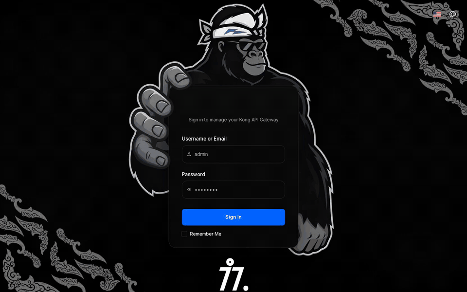
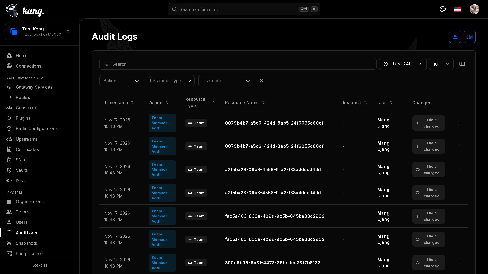
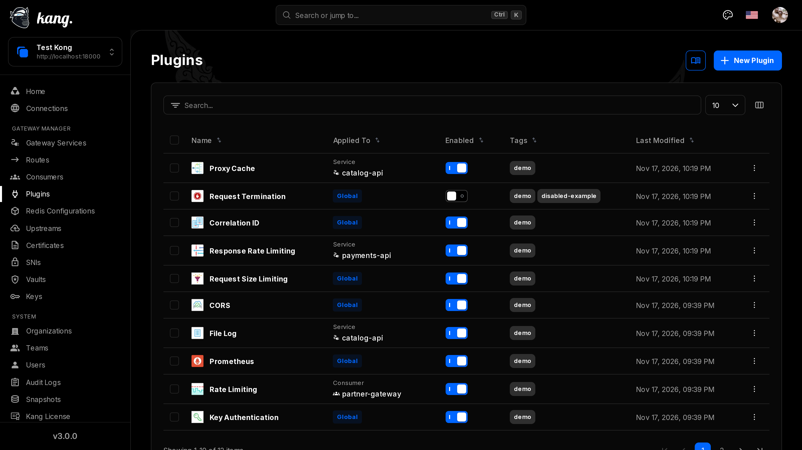
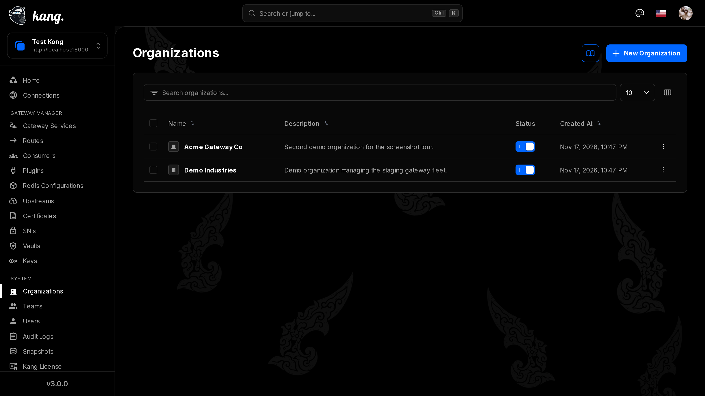
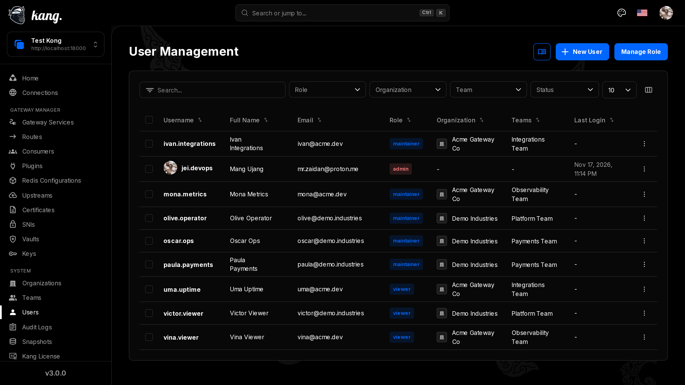
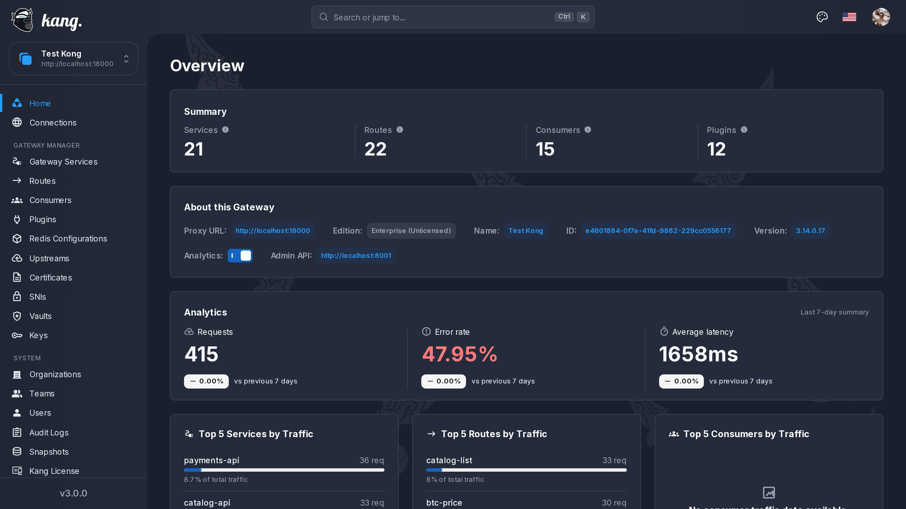
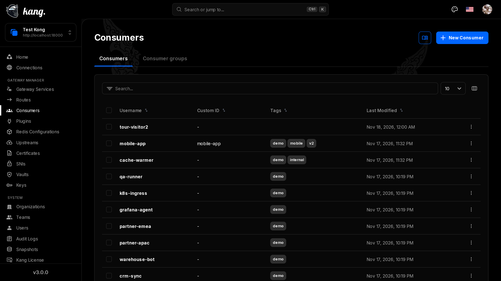
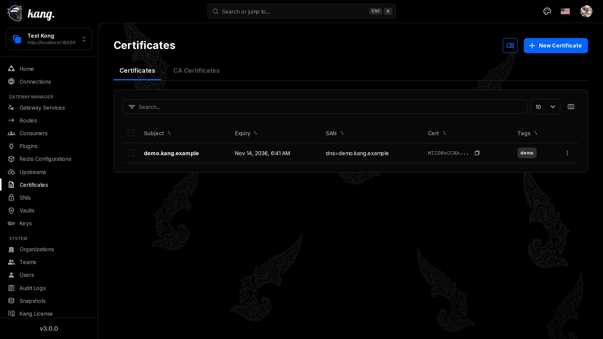
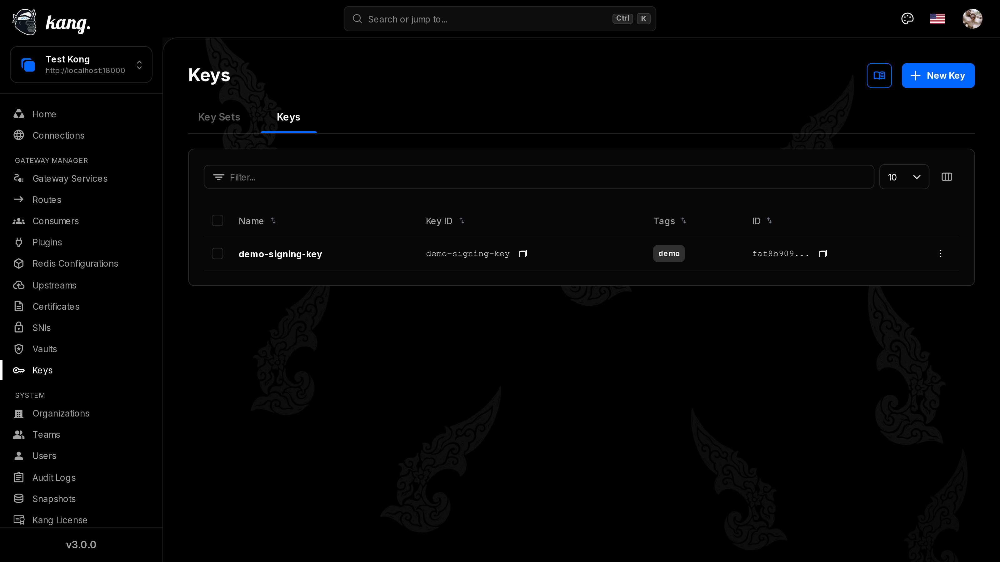
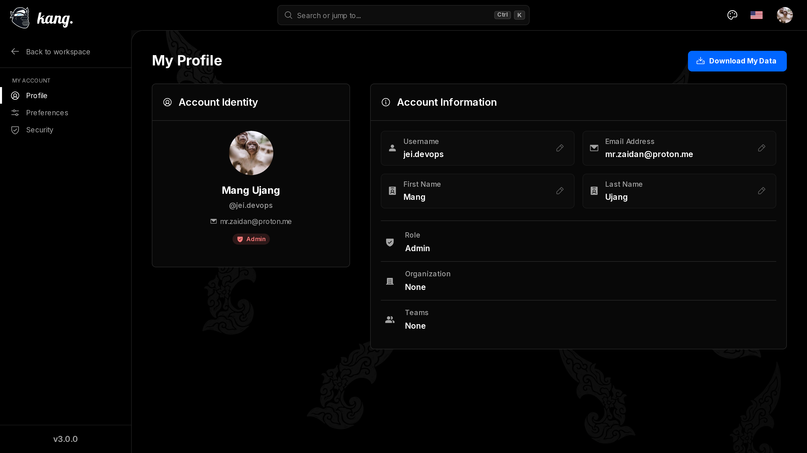

# Kang

[](https://github.com/zaidanm16/kang-deploy/releases)
[](https://github.com/zaidanm16/kang-deploy/actions/workflows/release.yaml)
[](https://zaidanm16.github.io/kang-deploy/)

**Manage your Kong gateways from one place.**

Kang is a self-hosted web application for managing Kong API Gateway. It gives individual operators and teams a UI to configure services, routes, consumers, and plugins, switch between gateway environments, and review administrative activity.

Use Kang to work with staging and production gateways without maintaining a separate management tool for each one. Connections are part of the URL, so you can keep different environments open in separate browser tabs. Access still depends on the signed-in user's permissions.

### What you can do

- Configure gateway services, routes, consumers, plugins, upstreams, certificates, and other supported Kong resources.
- Manage multiple gateway connections from one workspace.
- Review audit activity and, with Pro, inspect change details and manage configuration snapshots.
- With Pro, collaborate through additional users, organizations, teams, and permissions.
- View traffic metrics when a Prometheus-compatible service is configured and analytics is enabled.

Kang manages **existing Kong gateways** through their Admin APIs. It does not replace Kong's proxy or install Kong itself. Available gateway features also depend on your Kong version and edition.

This is Kang's public home for installation files and documentation. The application source is closed source; the deployment configuration and docs here are MIT licensed.



### Screenshots

| Overview | Gateway Services | Audit Logs |
| --- | --- | --- |
|  |  |  |

| Plugins | Kong Connections | Service analytics |
| --- | --- | --- |
|  |  |  |

| Organizations | Teams | Users |
| --- | --- | --- |
|  |  |  |

**Themes** — Classic, Gold, Black & Blue, and Black & Gold:

| Classic | Gold | Black & Blue | Black & Gold |
| --- | --- | --- | --- |
|  |  |  |  |

<details>
<summary>More screenshots</summary>

| Routes | Consumers | Upstreams |
| --- | --- | --- |
|  |  |  |

| Certificates | Vaults | Keys |
| --- | --- | --- |
|  |  |  |

| Redis Configurations | Users | Profile |
| --- | --- | --- |
|  |  |  |

</details>

### Free and Pro

Free requires no license key and includes Gateway Manager, up to 2 connections, 1 user, and the audit activity list. Pro adds unlimited connections and users, organizations, teams, snapshots, and audit change details. Pro requires a valid license; after expiry and a 7-day grace period, application access locks until renewal. Login and license installation remain available, and data is retained.

Start with Docker Compose below, or use the published Helm chart on Kubernetes. Documentation source lives in [`docs/`](docs/README.md).

## Getting started

The quickest way to try Kang is with **Docker Compose**. You need Docker with the Compose plugin, `git`, and `openssl`.

```sh
git clone --depth 1 --branch v3.0.0 https://github.com/zaidanm16/kang-deploy.git
cd kang-deploy/compose
cp backend.env.example backend.env
(umask 077; printf 'JWT_SECRET=%s\nPOSTGRES_PASSWORD=%s\n' "$(openssl rand -hex 32)" "$(openssl rand -hex 32)" > .env)
docker compose up -d
```

The chart and application images are public and can be downloaded without registry login.

Open **http://localhost:3000**. Get the one-time setup token with `docker compose logs backend`, then follow the setup screen to create your administrator and connect an existing Kong Admin API. The Admin API must be reachable from the backend container; `localhost` inside a container refers to that container.

This starts the frontend, backend, and PostgreSQL with persistent storage. Kang starts on the Free plan; no license key is required. To stop it, run `docker compose down` from the same directory. Your database is retained.

For public URLs, HTTPS, external services, and updates, see the [Compose guide](compose/README.md).

## Kubernetes

Use the **published Helm chart** with an existing Kubernetes cluster and a default StorageClass. The default chart also installs the CloudNativePG operator, which requires cluster-scoped permissions.

```sh
kubectl create namespace kang
secret_file="$(mktemp)"
openssl rand -hex 32 > "$secret_file"
kubectl -n kang create secret generic kang-backend-secrets \
  --from-file=JWT_SECRET="$secret_file"
rm -f "$secret_file"

helm upgrade --install kang oci://ghcr.io/zaidanm16/kang \
  --version 3.0.0 \
  --namespace kang \
  --set backend.secret.existingName=kang-backend-secrets \
  --set backend.env.AUTH_COOKIE_SECURE=false
```

For local access, run these in separate terminals, then open http://localhost:3000:

```sh
kubectl -n kang port-forward svc/kang-backend 8080:8080
kubectl -n kang port-forward svc/kang-frontend 3000:3000
```

See the [chart guide](charts/kang/README.md) for external databases, storage, HTTPS, Ingress, Gateway API, and custom values. A [standalone Kubernetes manifest](kubernetes/README.md) is also available.

## Releases

Release **v3.0.0** includes the chart and frontend version `3.0.0`. Backend images are pinned independently; the current default is `ghcr.io/zaidanm16/kang-backend:1.0.0`.

The [release workflow](.github/workflows/release.yaml) publishes these artifacts when a matching `v*` tag is pushed:

| Artifact | Use |
| --- | --- |
| `oci://ghcr.io/zaidanm16/kang:3.0.0` | Install with Helm using `--version 3.0.0` |
| `oci://ghcr.io/zaidanm16/kang:v3.0.0` | Alias for the same chart artifact |
| `kang-3.0.0.tgz` | Packaged chart with its pinned CloudNativePG dependency |
| `kang-compose.tar.gz` | Docker Compose stack, environment examples, and guide |
| `kang.yaml`, `kubernetes-README.md` | Standalone Kubernetes deployment |
| `SHA256SUMS` | Checksums for the downloadable files |

Chart `version` must match the release tag without `v`. `appVersion` records the frontend version. Application image tags retain the upstream `v` prefix. The `v3.0.0` OCI tag is an alias of the standard Helm tag `3.0.0`; Helm installation examples use `--version 3.0.0`. GitHub lists OCI Helm charts under container Packages because they use the same registry format. Registry packages must be public for anonymous downloads; private packages require registry authentication.

Update the release badge alongside the documented release version.

## Contributing

Contributions here cover installation configuration and product documentation. Chart sources live in `charts/kang`; the Starlight documentation site lives in `docs`. The frontend and backend application source is maintained separately.

Validate source changes before publishing:

```sh
helm dependency build ./charts/kang
helm lint ./charts/kang --set backend.secret.existingName=validation-secret
helm template kang ./charts/kang --set backend.secret.existingName=validation-secret
JWT_SECRET=validation-only POSTGRES_PASSWORD=validation-only \
  docker compose -f compose/compose.yaml --env-file compose/.env.example \
  config --no-env-resolution --quiet
```

Update `charts/kang/Chart.yaml` and the documented release version together, commit and push, then create the matching tag. The workflow packages the artifacts, pushes the OCI chart, and creates the GitHub Release:

```sh
git tag v3.0.0
git push origin v3.0.0
```

Never commit credentials, signing keys, signed license keys, or local environment files. Rendering validates generated configuration; runtime deployment also depends on storage, controllers, and network reachability.

## License

The deployment configuration and documentation in this repository are available under the [MIT License](LICENSE). The bundled CloudNativePG Helm chart is licensed separately under Apache-2.0; see the [third-party notices](charts/kang/THIRD_PARTY_NOTICES.md). The Kang frontend and backend are separate projects with their own licenses.
