# Kang

[](https://github.com/zaidanm16/kang/releases)
[](https://github.com/zaidanm16/kang/actions/workflows/release.yaml)
[](https://zaidanm16.github.io/kang/)

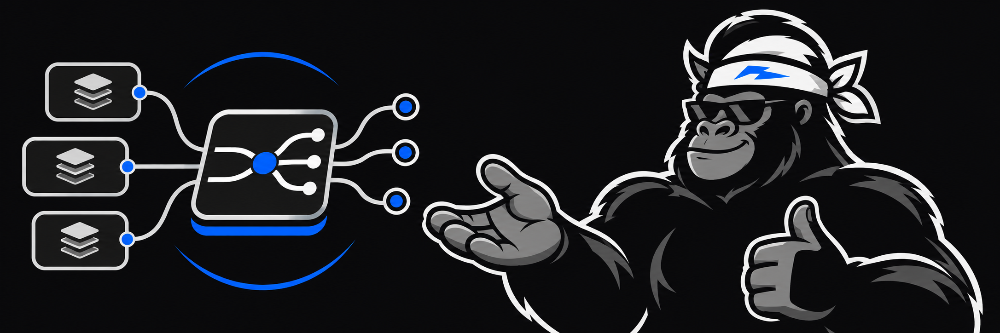

**Manage your Kong gateways from one place.**

Try the live demo at **[zaidanm16.github.io/kang-demo](https://zaidanm16.github.io/kang-demo/)** — a static, mock-data build of the interface, no gateway or database required.

Kang is a self-hosted web application for managing Kong API Gateway. It gives individual operators and teams a UI to configure services, routes, consumers, and plugins, switch between gateway environments, and review administrative activity. The interface ships in English, Bahasa Indonesia, Spanish, French, and Japanese.

Use Kang to work with staging and production gateways without maintaining a separate management tool for each one. Connections are part of the URL, so you can keep different environments open in separate browser tabs. Access still depends on the signed-in user's permissions.

### What you can do

- Configure gateway services, routes, consumers, plugins, upstreams, certificates, and other supported Kong resources.
- Manage multiple gateway connections from one workspace.
- Review audit activity and, with Pro, inspect change details and manage configuration snapshots.
- With Pro, collaborate through additional users, organizations, teams, and permissions.
- View traffic metrics when a Prometheus-compatible service is configured and analytics is enabled.

Kang manages **existing Kong gateways** through their Admin APIs. It does not replace Kong's proxy or install Kong itself. Available gateway features also depend on your Kong version and edition.


### Screenshots

| Overview | Gateway Services | Audit Logs |
| --- | --- | --- |
|  | 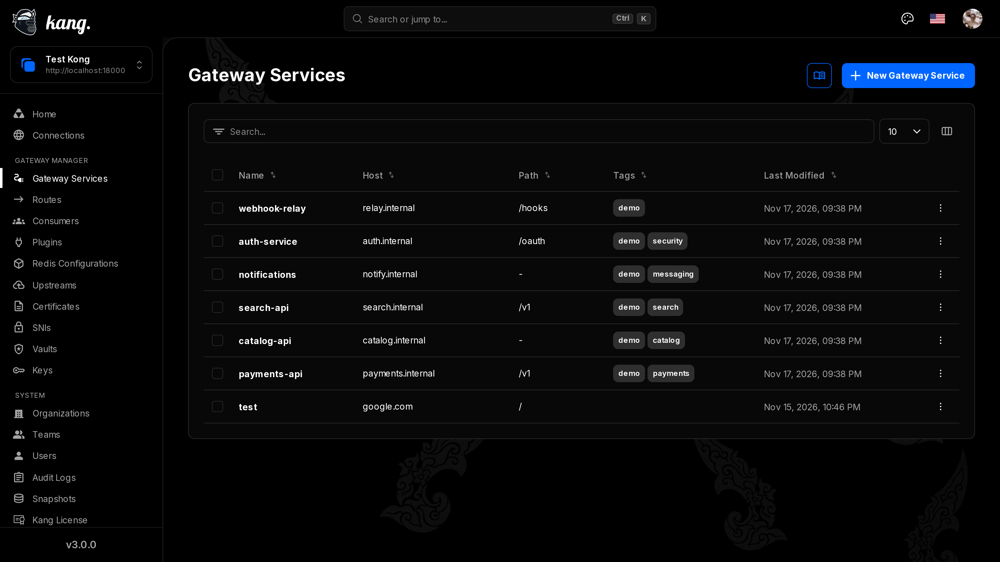 |  |

| Plugins | Kong Connections | Service analytics |
| --- | --- | --- |
|  | 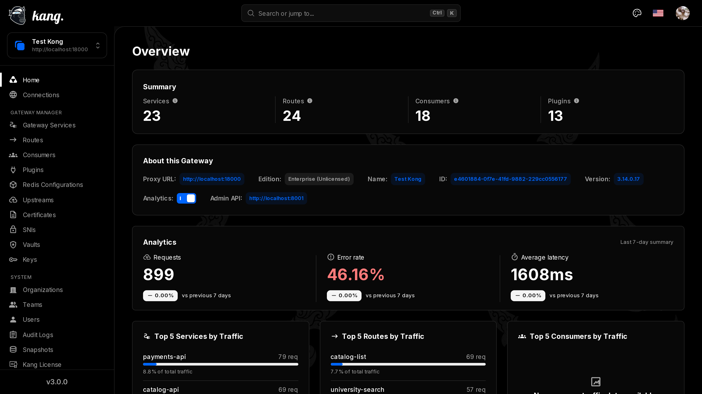 | 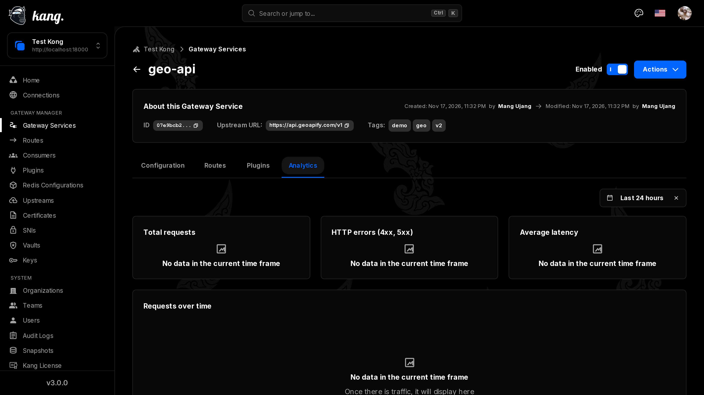 |

| Organizations | Teams | Users |
| --- | --- | --- |
|  | 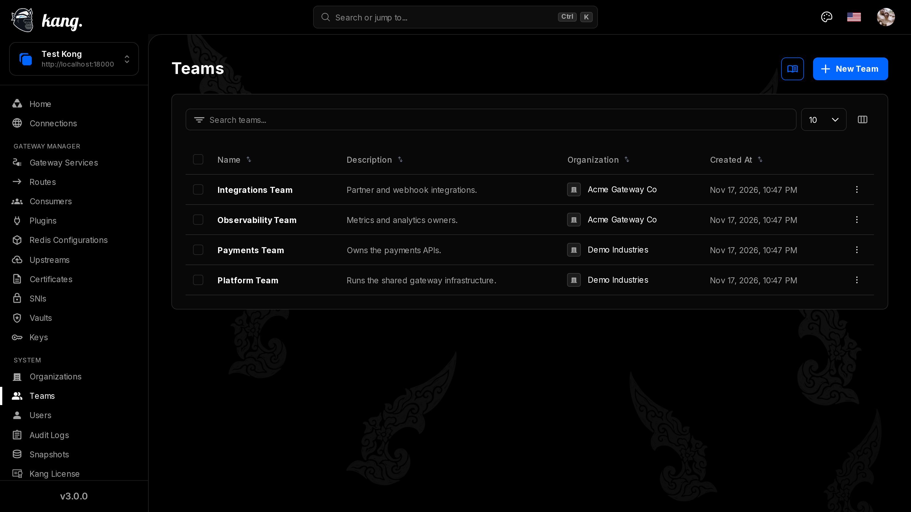 |  |

| Consumers | Audit Logs | Create service |
| --- | --- | --- |
| 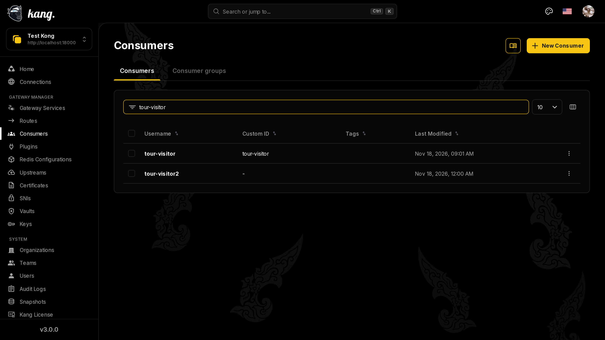 |  | 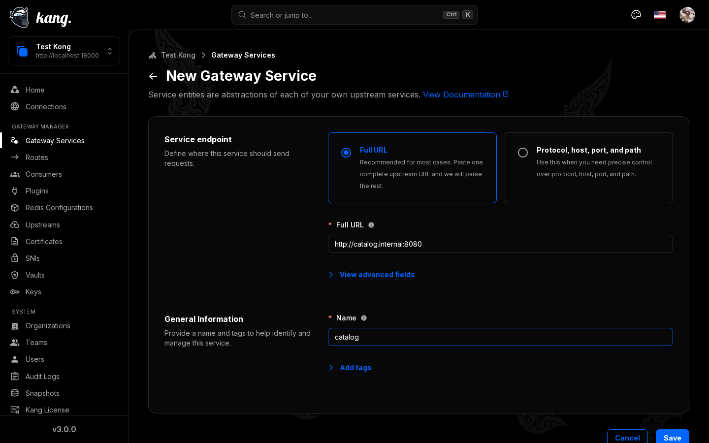 |

**Themes** — Nila, Kunang, Samudra, and Harimau:

| Nila | Kunang | Samudra | Harimau |
| --- | --- | --- | --- |
|  | 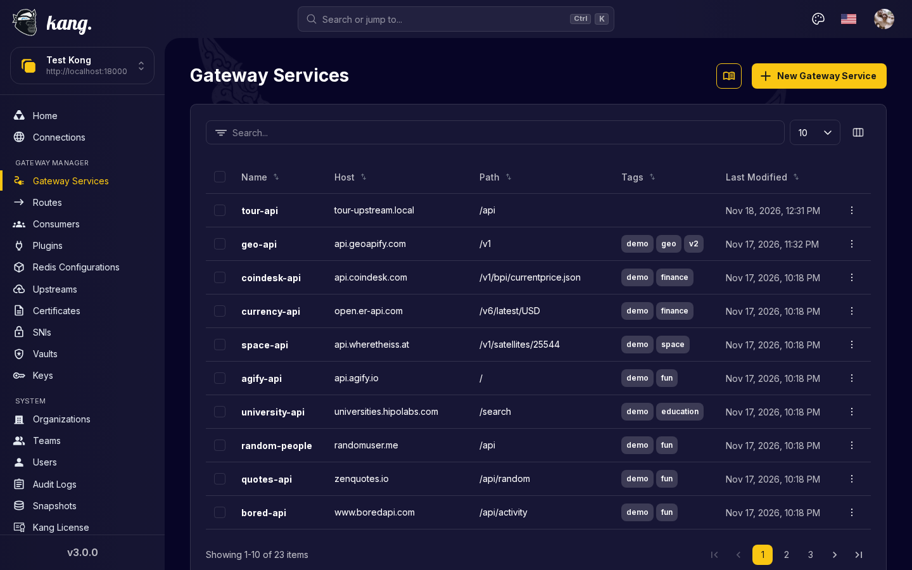 | 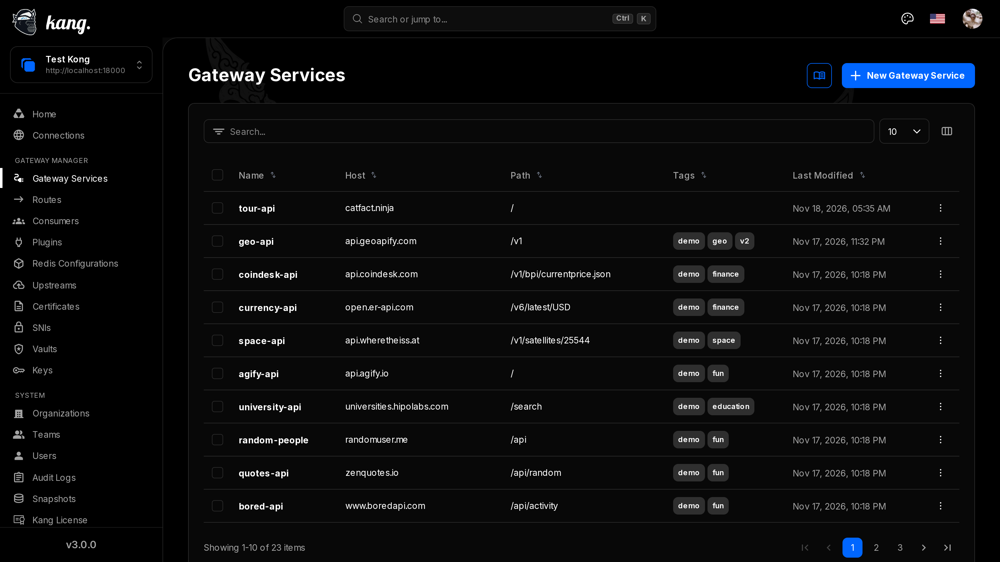 | 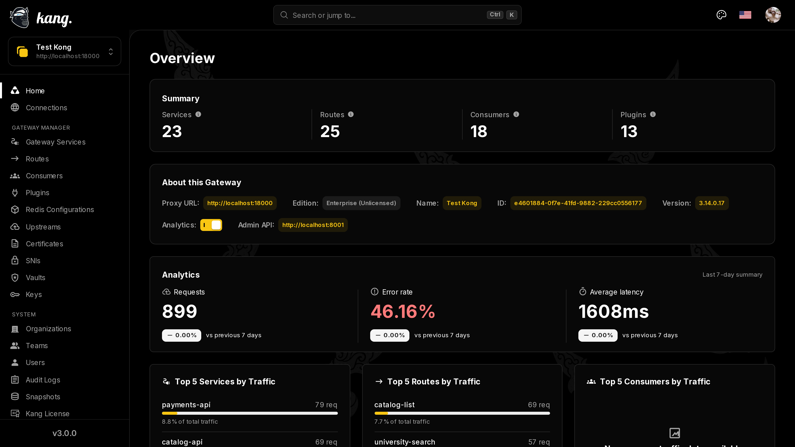 |

**Languages** — the interface is fully translated; switch it any time from the header:

| Bahasa Indonesia | Español | Français | 日本語 |
| --- | --- | --- | --- |
| 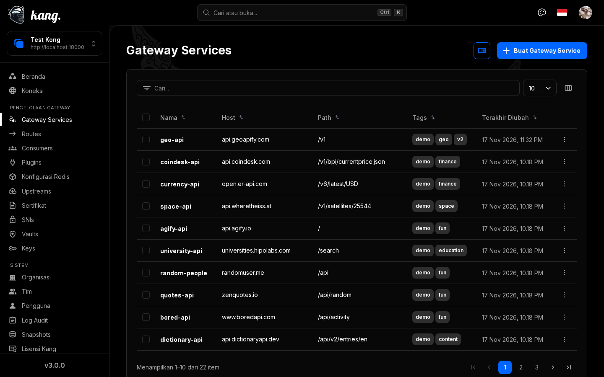 | 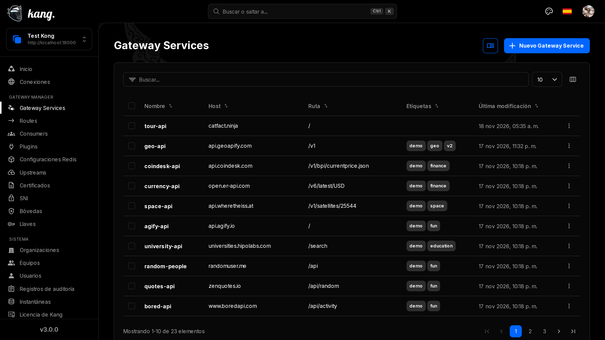 | 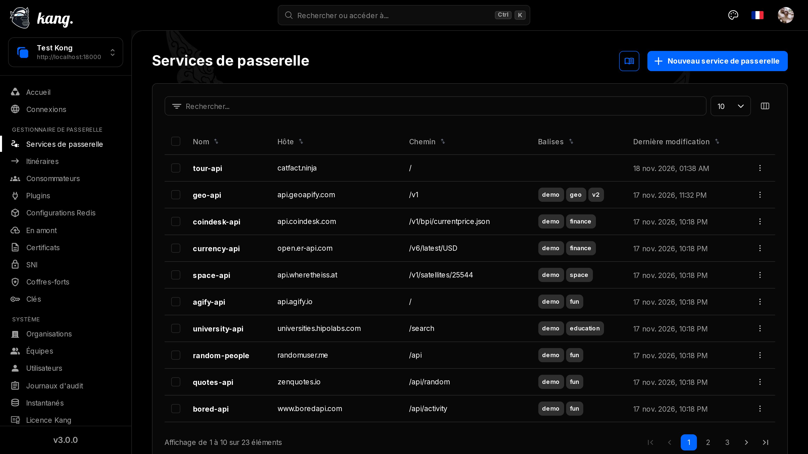 | 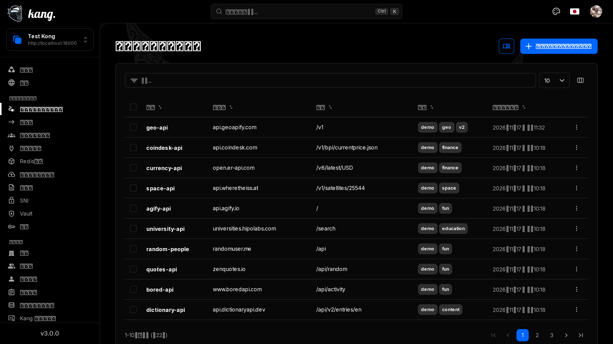 |

<details>
<summary>More screenshots</summary>

| Routes | Consumers | Upstreams |
| --- | --- | --- |
| 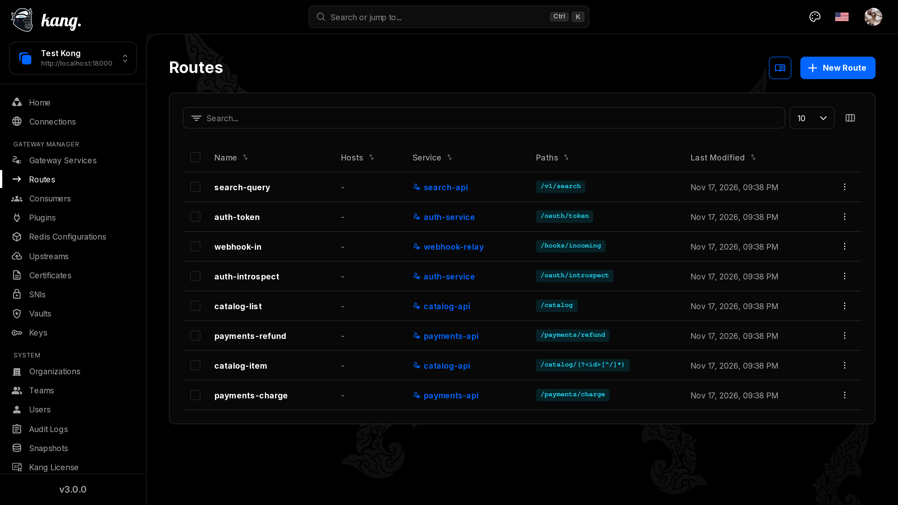 |  | 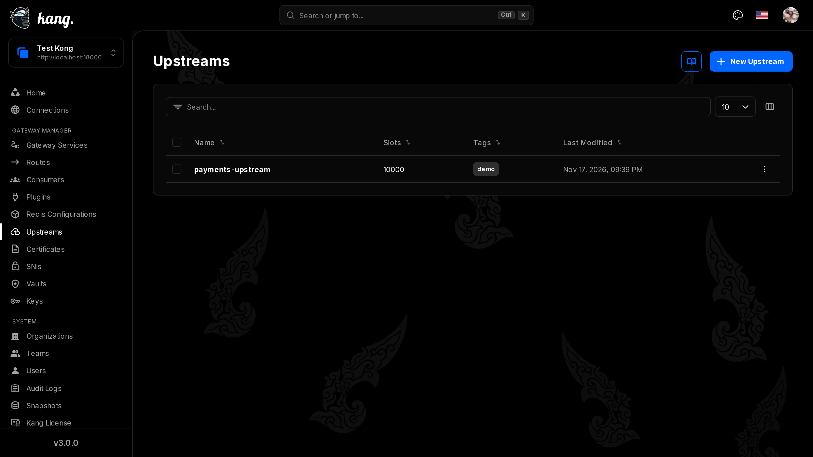 |

| Certificates | Vaults | Keys |
| --- | --- | --- |
|  | 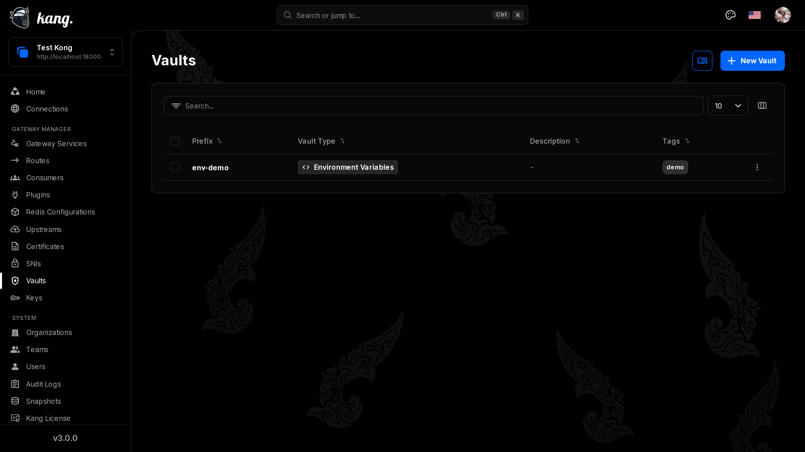 |  |

| Redis Configurations | Users | Profile |
| --- | --- | --- |
| 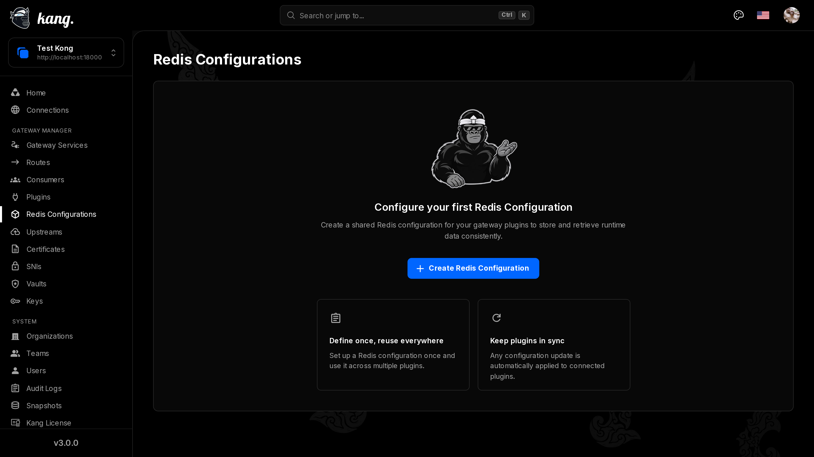 |  |  |

</details>

### Free and Pro

Free requires no license key and includes Gateway Manager, up to 2 connections, 1 user, and the audit activity list. Pro adds unlimited connections and users, organizations, teams, snapshots, and audit change details. Pro requires a valid license; after expiry and a 7-day grace period, application access locks until renewal. Login and license installation remain available, and data is retained.

Install or replace signed licenses through **System → Kang License** as a global or organization administrator. Only global administrators may remove a license; replacement affects the whole installation. Configure the issuer's `KANG_LICENSE_PUBLIC_KEYS` on the backend and leave `KANG_LICENSE` unset for UI management. The signed token is stored in the application database; keep an independent private backup anywhere safely recoverable. The private signing key stays with the issuer. See [license management and recovery](https://zaidanm16.github.io/kang/guides/plans/).

Start with Docker Compose below, or use the published Helm chart on Kubernetes. Documentation source lives in [`docs/`](docs/README.md).

## Getting started

The quickest way to try Kang is with **Docker Compose**. You need Docker with the Compose plugin, `git`, and `openssl`.

```sh
# Clone the deployment files at the current release
git clone --depth 1 --branch v3.2.1 https://github.com/zaidanm16/kang.git
cd kang/compose
# Create backend configuration from the example (backend-only variables like CORS and session settings)
cp backend.env.example backend.env
# Generate two random secrets into .env: JWT_SECRET signs login sessions, POSTGRES_PASSWORD secures the database
(umask 077; printf 'JWT_SECRET=%s\nPOSTGRES_PASSWORD=%s\n' "$(openssl rand -hex 32)" "$(openssl rand -hex 32)" > .env)
# Start the stack in the background: PostgreSQL, backend, and frontend
docker compose up -d
```

- `.env` — Compose-level settings: image tags, published ports, and the two secrets above.
- `backend.env` — backend process settings: `CORS_ORIGINS` (the frontend origin), rate limits, session lifetimes. See the [backend environment reference](https://github.com/zaidanm16/kang-backend/blob/main/.env.example) for everything.
- `docker compose logs backend` — prints the one-time setup token you need on first open.
- `docker compose down` — stops the stack but keeps your database; add `-v` to delete it.

Open **http://localhost:3000**. Get the one-time setup token with `docker compose logs backend`, then follow the setup screen to create your administrator and connect an existing Kong Admin API. The Admin API must be reachable from the backend container; `localhost` inside a container refers to that container.

This starts the frontend, backend, and PostgreSQL with persistent storage. Kang starts on the Free plan; no license key is required. To stop it, run `docker compose down` from the same directory. Your database is retained.

For public URLs, HTTPS, external services, and updates, see the [Compose guide](compose/README.md).

## Kubernetes

Use the **published Helm chart** with an existing Kubernetes cluster and a default StorageClass. The default chart also installs the CloudNativePG operator, which requires cluster-scoped permissions.

```sh
# Create the namespace and a Secret holding the backend JWT secret
kubectl create namespace kang
secret_file="$(mktemp)"
openssl rand -hex 32 > "$secret_file"
kubectl -n kang create secret generic kang-backend-secrets \
  --from-file=JWT_SECRET="$secret_file"
rm -f "$secret_file"

# Install the chart from the public OCI registry (version matches the release)
helm upgrade --install kang oci://ghcr.io/zaidanm16/kang \
  --version 3.2.1 \
  --namespace kang \
  --set backend.secret.existingName=kang-backend-secrets \
  --set backend.env.AUTH_COOKIE_SECURE=false
```

- The Secret provides `JWT_SECRET` for login-session signing, not the private key for issuing offline licenses. Keep secret values out of committed chart values and shell history.
- `helm upgrade --install` installs the chart (or upgrades it if it already exists). It deploys the CloudNativePG operator and a PostgreSQL cluster by default, which requires cluster-scoped permissions.
- If a CNPG operator already exists, set `cnpg.operator.enabled=false` and keep `cnpg.cluster.enabled=true` to create only Kang's database cluster. Ensure the existing operator watches Kang's namespace; see [existing-operator setup](https://zaidanm16.github.io/kang/installation/kubernetes/#use-an-existing-cloudnativepg-operator).
- `AUTH_COOKIE_SECURE=false` is for local HTTP testing only — keep it `true` (the default) behind HTTPS.
- `kubectl port-forward` tunnels the backend and frontend services to your local machine for local access.

See the [chart guide](charts/kang/README.md) for external databases, storage, HTTPS, Ingress, Gateway API, and custom values. A [standalone Kubernetes manifest](kubernetes/README.md) is also available.

Before changing an existing Helm installation, export its current values and preserve unrelated settings. Before moving its database, preserve `KONG_CREDENTIAL_ENCRYPTION_KEY` and verify restored object ownership and authenticated API access. Changing the encryption key alone breaks saved credential decryption. Follow the [operations guide](https://zaidanm16.github.io/kang/guides/operations/) for migration, coordinated key rotation, and Secret-backed Helm updates.

Profile photo and organization logo uploads require Cloudinary. Configure `CLOUDINARY_CLOUD_NAME`, `CLOUDINARY_API_KEY`, and `CLOUDINARY_API_SECRET` on the backend using a private env file or Kubernetes Secret. See [Cloudinary setup](https://zaidanm16.github.io/kang/guides/operations/#enable-photo-uploads-with-cloudinary); the API secret must never be sent to the browser or committed.

## Releases

Release **v3.2.1** includes frontend version `3.2.1` and backend image `ghcr.io/zaidanm16/kang-backend:v1.2.0`. The chart version is independent of either application version.

The [release workflow](.github/workflows/release.yaml) publishes these artifacts when a matching `v*` tag is pushed:

| Artifact | Use |
| --- | --- |
| `oci://ghcr.io/zaidanm16/kang:3.2.1` | Install with Helm using `--version 3.2.1` |
| `kang-3.2.1.tgz` | Packaged chart with its pinned CloudNativePG dependency |
| `kang-compose.tar.gz` | Docker Compose stack, environment examples, and guide |
| `kang.yaml`, `kubernetes-README.md` | Standalone Kubernetes deployment manifest and its guide |
| `SHA256SUMS` | Checksums for the downloadable files |

Chart `version` must match the release tag without `v`. `appVersion` records the frontend version. Application image tags retain the upstream `v` prefix. GitHub lists OCI Helm charts under container Packages because they use the same registry format.

Version references in this README, the Compose guide, and the installation docs are updated automatically: after creating a GitHub Release, the workflow commits the new version with `scripts/update-versions.sh`. You can also run it manually: `scripts/update-versions.sh <version>`.

## Contributing

Contributions here cover installation configuration and product documentation. Chart sources live in `charts/kang`; the Starlight documentation site lives in `docs`. The frontend and backend application source is maintained separately.

Validate source changes before publishing:

```sh
helm dependency build ./charts/kang
helm lint ./charts/kang --set backend.secret.existingName=validation-secret
helm template kang ./charts/kang --set backend.secret.existingName=validation-secret
JWT_SECRET=validation-only POSTGRES_PASSWORD=validation-only \
  docker compose -f compose/compose.yaml --env-file compose/.env.example \
  config --no-env-resolution --quiet
```

Update `charts/kang/Chart.yaml` and the documented release version together, commit and push, then create the matching tag. The workflow packages the artifacts, pushes the OCI chart, and creates the GitHub Release:

```sh
git tag v3.2.1
git push origin v3.2.1
```

Never commit credentials, signing keys, signed license keys, or local environment files. Rendering validates generated configuration; runtime deployment also depends on storage, controllers, and network reachability.

## License

The deployment configuration and documentation in this repository are available under the [MIT License](LICENSE). The bundled CloudNativePG Helm chart is licensed separately under Apache-2.0; see the [third-party notices](charts/kang/THIRD_PARTY_NOTICES.md). The Kang frontend and backend are separate projects with their own licenses.
