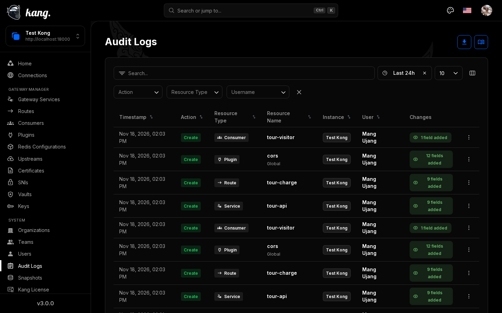

**Audit Logs** records administrative activity in Kang, not every HTTP request through Kong. Access requires audit-read permission and follows the [platform access rules](/kang/administration/organizations-teams/#permissions-and-scope).

## Find an event

1. Open Audit Logs.
2. Set the time range, then use search and the Action, Resource Type, and Username filters as needed.
3. Review timestamp, action, resource, instance, and user together.
4. Clear filters when expected events are missing; check time range and pagination before concluding there is no record.

For a scoped plugin, the resource name includes its associated entity when available, such as `http-log` with `Service: catalog`. This distinguishes identically named plugin instances on different resources. Older records may not contain that context.

## Inspect changes

Free shows the activity list. Pro provides field-level change details through the **Changes** control. Use these to understand additions, updates, or removals; do not assume a count alone describes the business impact. The connected instance is important when the same resource name exists in staging and production.

The Pro restriction is enforced by the backend. Exporting logs is not a workaround for obtaining hidden Free-plan change details.

## Export

1. Select the download/export button.
2. Choose **Current page**, **Timestamp range**, or **All logs**.
3. For a timestamp range, fill both boundaries and ensure the start is no later than the end. The range is inclusive.
4. Choose **CSV** or **JSON**, then **Export**.

Current page contains the displayed rows. Other scopes can include more data than the current table page; check the exported contents before sharing. Large exports may be limited by the installation's configured export limits. Protect downloaded files because activity metadata can reveal users, resource names, and infrastructure details.
