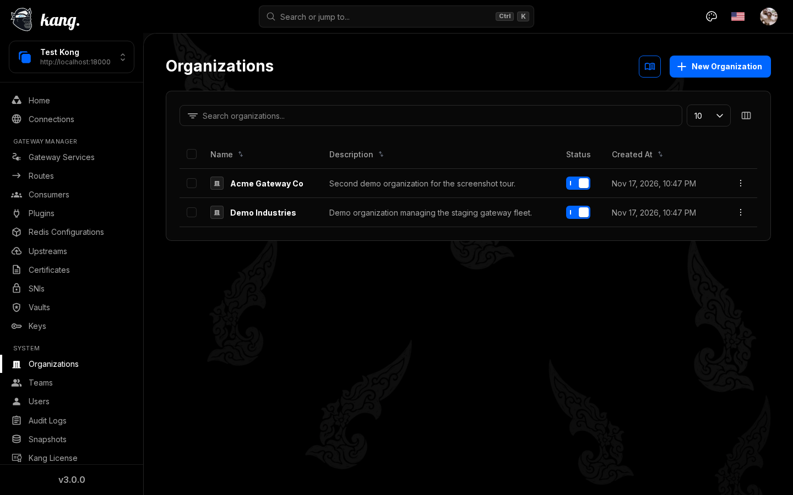
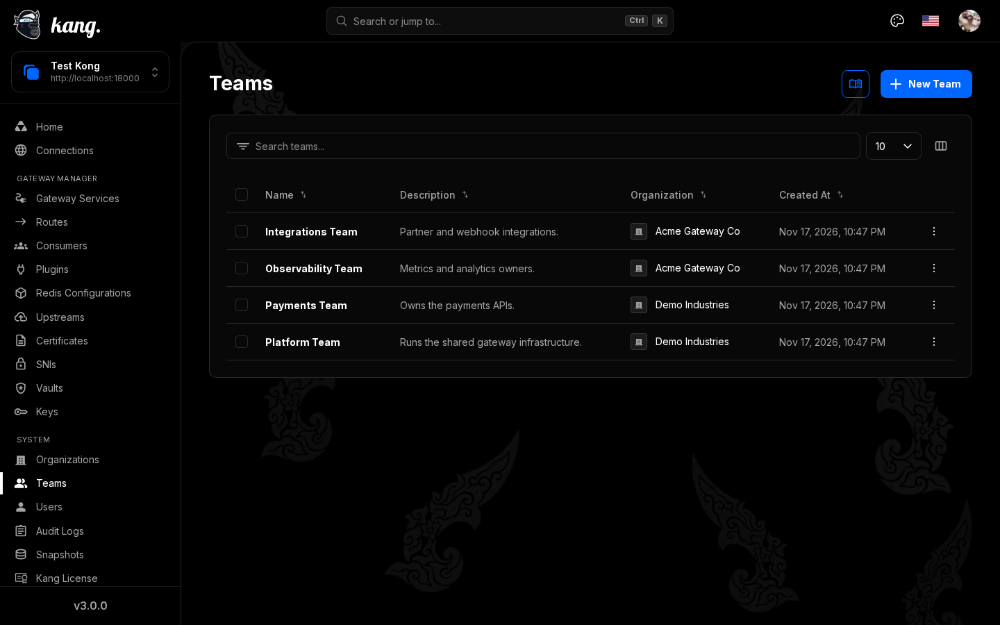

Organizations and teams are **Kang Pro** features. They organize dashboard users and gateway access, not Kong consumers or consumer groups.

## Set up access in order

1. Open **Organizations** and create the organization identity. Review its name, slug, optional description, and available logo settings.
2. Open **Teams** and create a team in that organization. An organization is required; create it first if the list is empty.
3. Assign the team's Kong instances under **Gateway Access**. You can also assign teams when configuring a connection if you have the corresponding permissions.
4. Create or edit users, select the organization, and assign its teams.
5. Sign in as an intended member to verify the correct connections and allowed actions.

Choose meaningful ownership boundaries. Creating an organization alone does not automatically give every member access to every connection. Check both team-to-instance assignments and user-to-team membership.

## Permissions and scope

Creating and editing organizations/teams uses user-management permissions; assigning gateway instances additionally requires the relevant instance permissions. Your role controls actions within the scope you can access.

Audit logs, snapshots, and role administration are installation-wide tools. Organization-scoped non-admin accounts cannot use them; the built-in `admin` role is exempt from that organization restriction. Global non-admin accounts still need the relevant permissions. Plan restrictions still apply. Do not assign `admin` to someone who must be limited to one organization.

## Change membership

Before removing a user from a team or changing connection assignments, identify the access that will disappear. Review the user's other memberships rather than assuming one removal revokes every route to a gateway. Inspect dependent members and teams before deleting an organization; read the application's validation instead of assuming cascade deletion.
