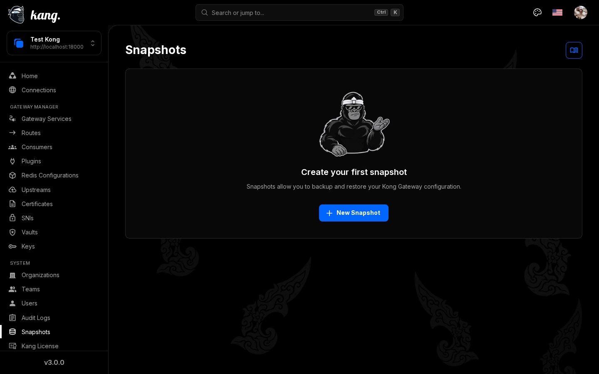

Snapshots capture supported **Kong configuration**, not the entire Kang database. This is a Pro workflow for global accounts with the relevant snapshot permissions. Restoring also requires authorization to write the selected gateway resources.

## Capture a snapshot

1. Select the source connection and open **Snapshots → Create Snapshot**.
2. Choose **Capture Current**.
3. Enter a required name and optional description, such as the change you are preparing for.
4. Select **Capture Snapshot** and wait for success. Required resource-read failures stop capture rather than silently producing a complete-looking backup.
5. Inspect the saved snapshot's metadata/JSON and keep an export if needed.

## Clone or import

**Clone Node** reads configuration from another Admin API using the authentication entered in the dialog. Use a base Admin API URL without credentials embedded in it. The source credentials are used for the operation and are not stored as snapshot credentials. Cloning saves a snapshot; it does not automatically overwrite the current gateway.

**Import File** accepts Kong declarative **JSON**, up to **10 MB** in the upload UI. The file is validated before creation. A YAML file is not the same input format. Snapshot data may contain sensitive gateway configuration; protect imported/exported files.

## Restore to a gateway

1. Open the snapshot's restore action and explicitly choose the **Target Kong Instance**.
2. Optionally enable **Customize snapshot JSON** to edit a temporary copy. Find/replace is available; these edits do not change the stored snapshot.
3. Review and select resources. Check dependencies and compatibility with the target version.
4. Start restore and keep the window open while it runs.
5. If a conflict occurs, inspect the resource and payload. Correct accepted fields and retry, or skip the resource when appropriate.
6. Inspect all results: restored, skipped, and failed. A partially completed restore is not a successful full restore.

Resources are processed in dependency order. Original IDs and timestamps are not guaranteed to survive a logical restore. **Skip Audit Logging**, when available, deliberately suppresses restore audit recording; leave it off if you need that history.

## Cancel and undo

Cancel stops further work but does not automatically revert successful operations. When **Undo Restore** is available in the current restore session, it deletes resources created by that restore and restores previous values for updated resources in reverse dependency order. Inspect undo results too: rollback can fail and is not an atomic database transaction. Do not close or refresh the dialog expecting undo state to persist.

Back up the target before important changes and verify live gateway behavior afterward. [Full Migration](/kang/administration/migration/) is a separate, optional maintenance workflow.
