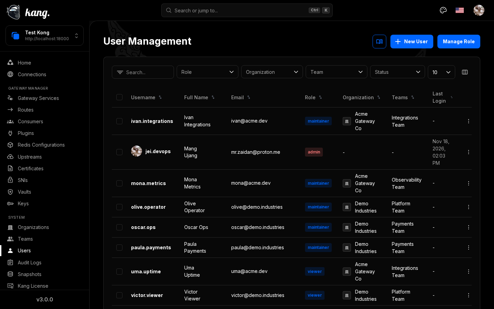

Kang users sign into the dashboard. Free allows **1 user per installation**. Pro allows additional users, but a license does not grant every user administrator privileges.

## Create a user

1. Open **Users → New User** with permission to create users.
2. Enter the unique username, initial password, first name, last name, and email. Follow the password policy shown below the password field.
3. Select the role. On Pro, optionally select an organization and then teams within that organization.
4. Review **Enable Account** and **Force password change on next login**.
5. Save and provide the user their login details through a private channel.

Teams are chosen after an organization because their membership belongs to that organization. An organization-scoped account is different from a global account without an organization.

## Edit and manage lifecycle

Open the user's edit action to change supported identity and access fields. On edit, leave **New Password** blank to keep the existing password. If resetting it, follow the current policy and consider forcing a change on the next login.

Use activate/deactivate or unlock actions when applicable and permitted. Deactivation prevents use of the account; an unlock addresses a login lock. Neither should be confused with deleting the user. Review session management when revoking access to a compromised device.

Existing profile photos appear before usernames in the list; accounts without a photo do not need an image. Photo management belongs to the user's own Profile and is not an avatar field on the administrator's create/edit form.

## Manage roles

Open **Manage Role** from User Management. The permission matrix shows actions by resource and role. With configuration-update permission, edit role permissions, review affected users, and save. Custom role creation requires a role code and name. The `admin` role's permissions are not edited like ordinary roles.

Permissions control actions; organization and team membership can limit scope. Role administration requires configuration permissions and follows the [platform access rules](/kang/administration/organizations-teams/#permissions-and-scope). If a user can see a resource but cannot save, check their update/create permission before changing their organization.

## Recover administrator access

If another administrator can sign in, have them check the account status, unlock or reactivate the account as appropriate, and reset the password if needed. If no administrator can sign in, use your deployment operator's private recovery procedure. Take a database backup first, verify that you are working on the Kang database, and verify login and revoke unwanted sessions after recovery. The first-run setup token is not a password reset mechanism.
