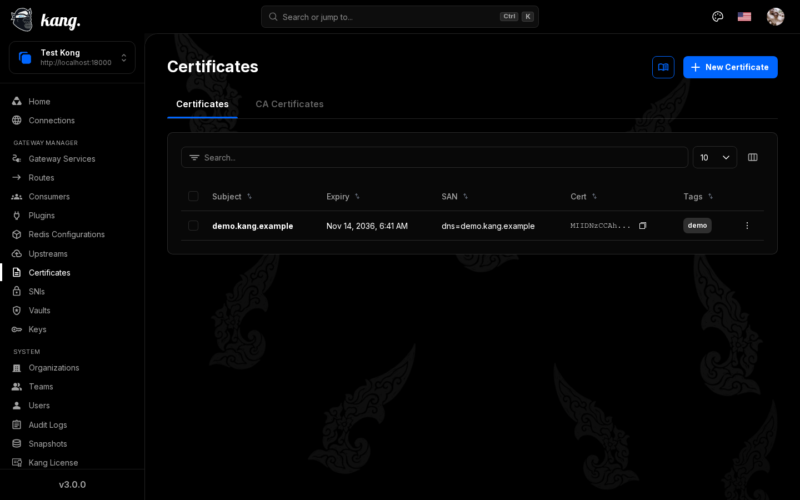

Use **Certificates** to manage server certificates and CA certificates, and **SNIs** to associate hostnames with server certificates. These are gateway TLS resources, not the certificate for the Kang website itself.

## Server certificate

1. Open Certificates and choose the server-certificate create action.
2. Paste the certificate and matching private key in the expected PEM fields. Supply alternate certificate/key material only if needed and supported.
3. Add optional tags, save, and inspect the resulting record.
4. Associate the appropriate SNI hostname with this certificate.

Keep the certificate chain valid and the private key paired with its certificate. Sensitive PEM/private-key fields are excluded from browser draft recovery; keep your source material securely available until saved.

## CA certificate

Open the CA certificate section and provide the CA certificate PEM and optional tags. CA certificates are trust material; where they are used depends on the service/plugin TLS configuration. Uploading a CA does not by itself enable mutual TLS or attach it to every service.

## SNI mapping

Create an SNI with the requested hostname and select the server certificate it should reference. Inspect the certificate relationship before saving. Test TLS using the real hostname: connecting by bare IP may not send the expected SNI.

## Rotate and remove

Provision the replacement certificate and key, update the relevant mapping or certificate record, then test the hostname's TLS connection and expiry. Check references before deletion. A browser TLS error on the Kang dashboard may instead belong to the reverse proxy serving Kang; editing a Kong certificate will not automatically repair it.
