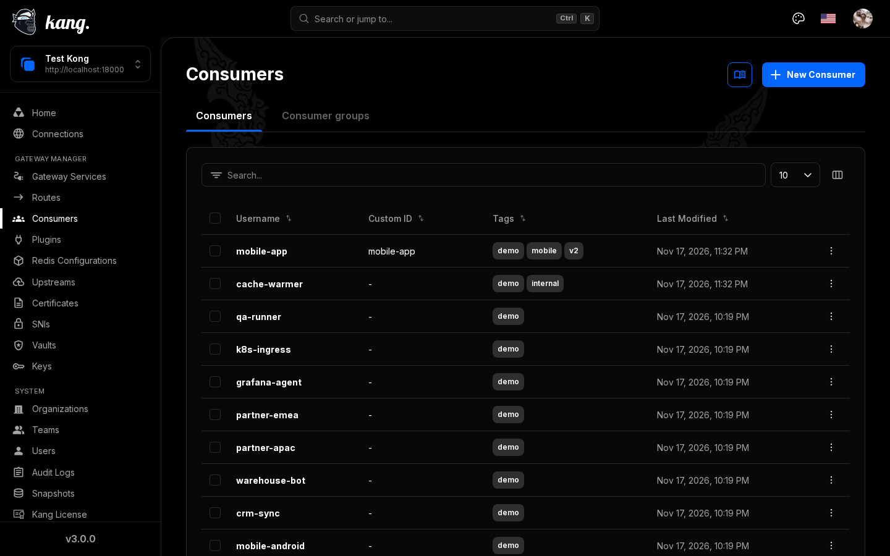
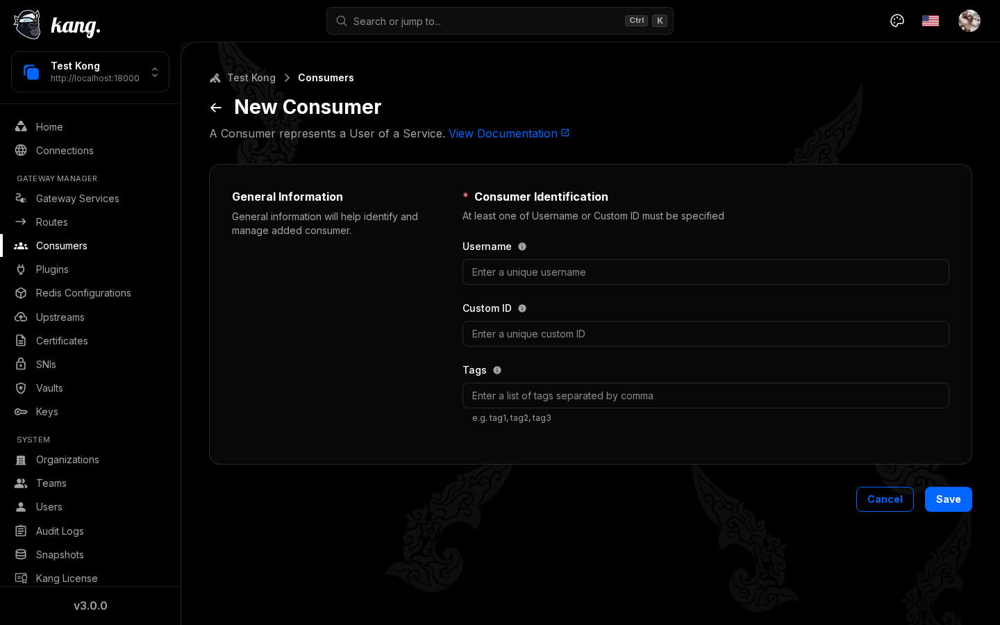

A consumer represents a client of your APIs. It is not a Kang login account. Manage dashboard accounts under **Users** instead.

## Create a consumer

1. Open **Consumers** and choose the create action.
2. Enter **Username**, **Custom ID**, or both. At least one is required; neither field is individually mandatory when the other is supplied.
3. Add optional tags and save.
4. Open the consumer detail page to manage credentials and scoped plugins.

Use a custom ID when mapping to an identifier in your own application. Avoid changing identifiers without checking integrations that depend on them.

## Add credentials

Open the relevant credential section and create a credential for the authentication plugin you use. The form supports ACL entries, Basic Authentication, Key Authentication, HMAC Authentication, and JWT credentials.

- **ACL:** assign a group value used by the corresponding ACL policy.
- **Basic Auth:** provide a username and password.
- **Key Auth:** create or supply a key as permitted by the form/gateway.
- **HMAC Auth:** configure the expected username and secret.
- **JWT:** select the algorithm and provide its required key/secret or public key fields. Algorithm choice determines the required material.

Enable the matching authentication plugin on the service, route, consumer scope where supported, or globally as appropriate. Creating a credential alone does not make a public route require authentication. Store secrets securely and re-enter sensitive values after a form refresh if necessary.

## Consumer groups

Where supported by the connected gateway, open **Consumer Groups**, create a group, add consumers, and configure supported group plugins. Check membership before changing a shared policy. Consumer groups are Kong resources; they are different from Kang **Teams**.

## Verification and removal

Test a request with and without the expected credential through the gateway proxy. Confirm the policy enforces the intended result. Deleting a credential can immediately stop its clients from authenticating. Prefer a coordinated rotation: provision the replacement, update clients, verify, then retire the old credential.
