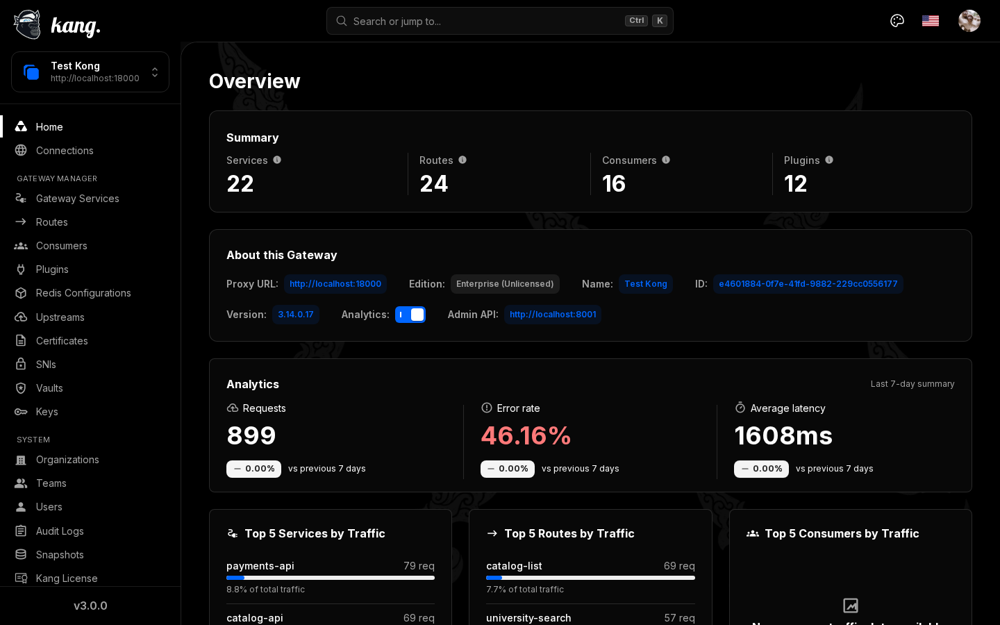

Open **Home** after selecting a connection. Resource counts summarize the selected gateway's services, routes, consumers, and plugins. **About this Gateway** shows connection information, gateway version/edition, proxy URL, and Admin API URL.

## Turn analytics on or off

Use the analytics control on Overview or **Profile → Preferences → Analytics**. When disabled, Kang skips traffic-metric requests but still displays configuration inventory. Enabling analytics is a preference; it does not deploy or configure a metrics server.

Your operator must configure a Prometheus-compatible query API, scrape the gateway metrics, and ensure the selected gateway's metrics can be identified. Metrics availability depends on that installation. Resource counts can load successfully even if traffic charts cannot.

## Read the charts

Choose the available time range and examine traffic, latency, and errors together. An empty chart can mean no requests in that interval, unavailable metrics, or a query/collection problem. It does not prove the gateway is down. Send a known test request through the proxy and compare the selected interval before escalating.

The analytics preference controls requesting metrics, not Kong's traffic processing. If pages feel slow and you only need configuration management, turn analytics off and retry.

## Configuration versus usage

A plugin distribution or resource count describes configured objects. Request-rate and latency charts describe observed traffic. Creating a service does not itself generate traffic. Always verify the selected connection when comparing environments.
