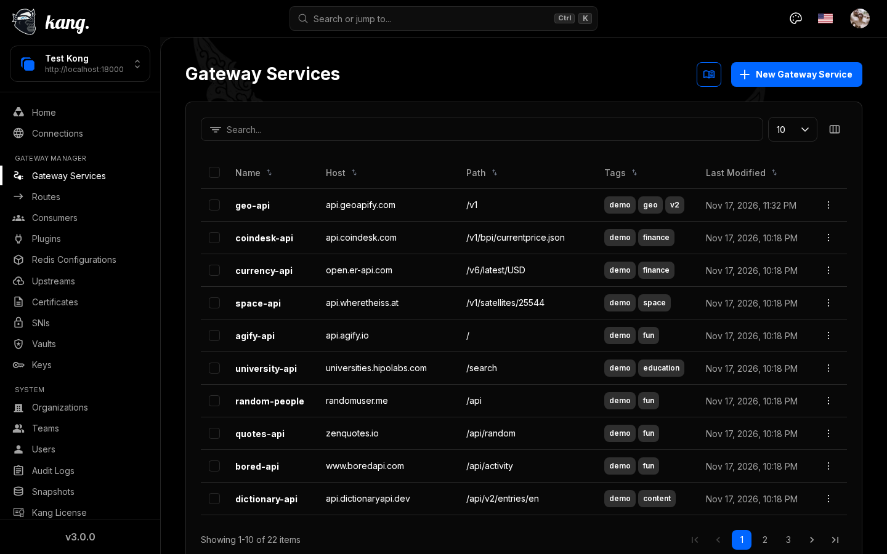
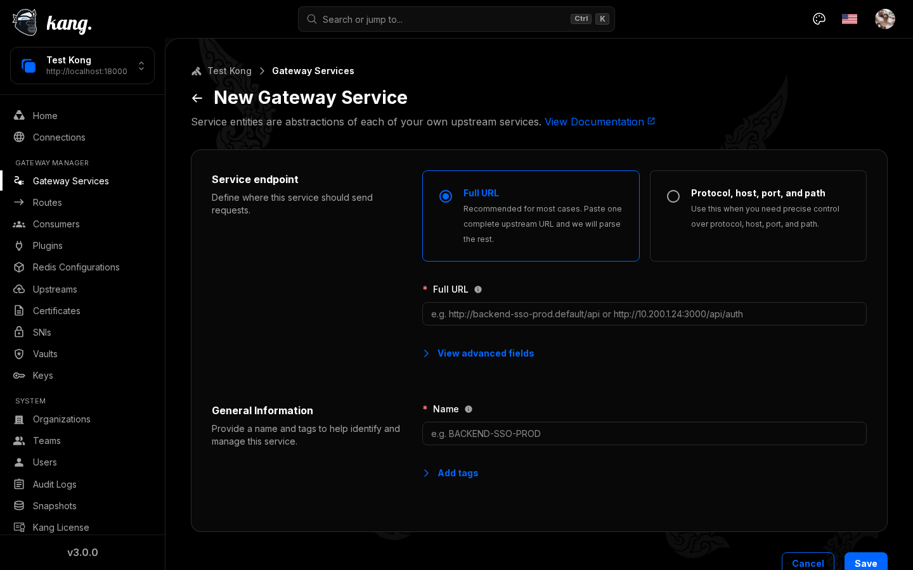

A service describes an upstream application that Kong can forward requests to. A route determines which requests reach it. Open **Gateway Services** for the selected connection.

## Create a service

1. Choose **New Gateway Service** and enter a descriptive name if you want to identify it by name.
2. Choose full URL mode or individual upstream fields.
3. For a full URL, provide the protocol, hostname, optional port, and path in one address. For individual fields, set **Protocol**, **Host**, and **Port**, plus an optional **Path**.
4. Review advanced settings, tags, and whether the service is enabled.
5. Save, then create or inspect its routes. A service without a matching route is not exposed by an ordinary proxy request.

## Connection settings

| Setting | What to check |
| --- | --- |
| Host | Reachable from Kong; use an upstream object's name if load balancing through that upstream |
| Port | Port the application actually listens on |
| Path | Base path Kong adds when forwarding |
| Retries | How many retries Kong may attempt under its gateway rules |
| Connection timeout | Time allowed to establish an upstream connection, in milliseconds |
| Write timeout | Upstream request-write timeout, in milliseconds |
| Read timeout | Upstream response-read timeout, in milliseconds |
| Tags | Labels for organizing resources; they do not grant access |

The connected gateway supplies schema validation. Do not assume every protocol or field combination works on every version.

## Change an existing service

Open its detail page, inspect configuration and associated routes/plugins, then edit the intended settings. A shared service change can affect every route referencing it. Use service-scoped plugins for policies that should follow that service, and check the plugin's **Applied To** scope.

## Diagnose upstream errors

For a connection failure or 502/504, check DNS, port, network access, protocol/TLS, and upstream health from Kong's environment. The fact that Kang can reach Kong's Admin API does not prove Kong can reach your application. Avoid increasing timeouts until you know why the upstream is slow.
