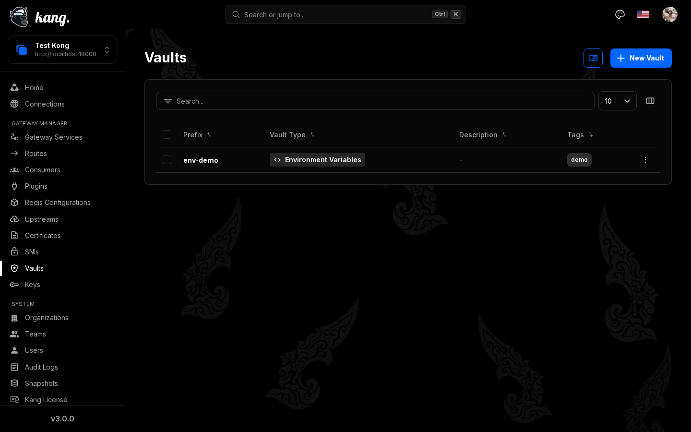

Kong vault entities configure how Kong resolves secret references from an external secret source. They do not turn Kang into a secret manager or automatically upload your secrets.

## Configure a vault

1. Open **Vaults** for the selected connection and create a vault.
2. Choose a backend supported by that gateway. The Kang form includes Environment, AWS, GCP, HashiCorp Vault, Azure, and Conjur options.
3. Enter a unique reference prefix and the provider configuration requested by the form.
4. Supply the correct location, authentication, or provider-specific settings, then save.
5. Reference the vault only in Kong configuration fields that support secret references. Verify resolution from the Kong runtime.

For the environment provider, the secret must exist in Kong's environment, not only in Kang's backend. For hosted secret managers, Kong needs network access and provider permissions to read the intended secret.

## Troubleshooting

A saved vault definition does not prove a secret can be resolved. Check reference prefix, secret path/key, provider permissions, and network/TLS settings. Backend options and required fields differ by Kong version and edition. If the gateway rejects a provider, check compatibility rather than switching Kang plans.

## Editing and deletion

Review resources using the prefix before changing it or deleting the vault. Unresolved references can prevent the dependent configuration from working. Sensitive provider configuration may not survive a browser refresh; re-enter it if the form requires it.
