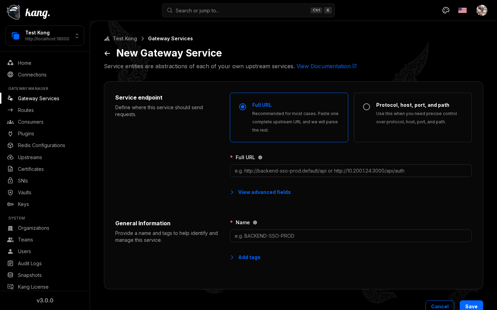
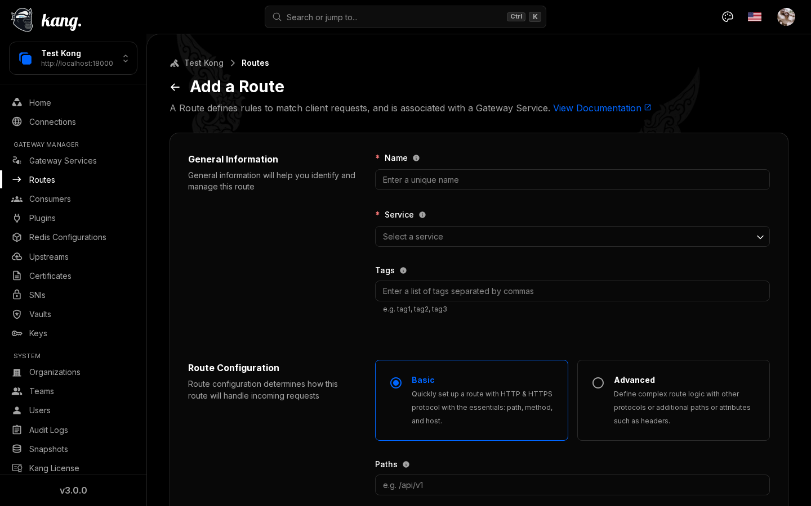

This example exposes an existing HTTP application through Kong. Use a test gateway first and replace the example addresses with yours. You need permission to create services and routes.

## 1. Create the service



1. Select your test connection and open **Gateway Services**.
2. Choose **New Gateway Service** and give it a recognizable name, such as `catalog`.
3. In URL mode, enter an upstream URL such as `http://catalog.internal:8080`. Alternatively, use the protocol, host, port, and optional path fields.
4. Save and inspect the service configuration. The upstream hostname must resolve from Kong, not merely from your laptop.

## 2. Create the route



1. Open **Routes** and choose its create action.
2. Give the route a name such as `catalog-api`, select the `catalog` service, and keep the HTTP/HTTPS protocol choices appropriate for your gateway.
3. Add `/catalog` to **Paths**. Add other conditions only if you want to restrict matching further.
4. Check **Strip Path**: when enabled, the matching route prefix is removed before forwarding. This matters if the upstream expects `/items` rather than `/catalog/items`.
5. Save and verify the route's service reference.

## 3. Send a request through the proxy

Use the **proxy URL**, not the Admin API URL. For a local proxy listening on port 8000:

```sh
curl -i http://localhost:8000/catalog/items
```

Replace the address and upstream path with your actual values. If the route also matches a host, send the expected `Host` header. A successful response depends on the upstream application and any enabled plugins.

## 4. Add a policy

Open the service or route's **Plugins** tab and add an available plugin. Verify **Applied To** before saving so the policy applies to the intended resource. For authentication, create a [consumer and credential]((/kang//gateway/consumers/) and enable the corresponding plugin; a consumer alone does not enforce authentication.

If the request fails, inspect [troubleshooting]((/kang//guides/troubleshooting/) and check the selected connection before changing anything else.
