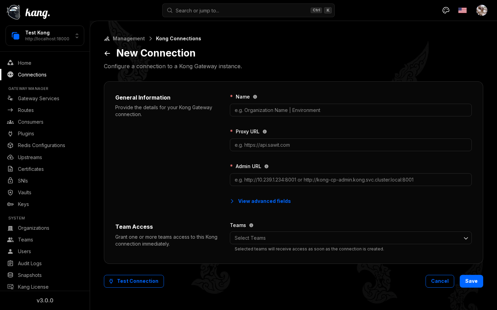
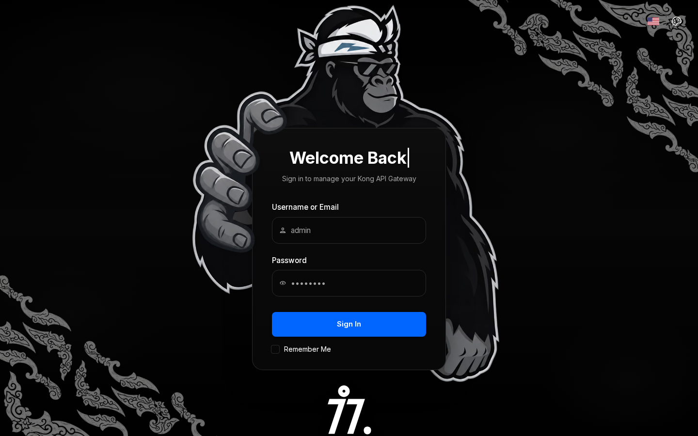

## Before you begin

Have the Kang frontend URL, a reachable Kong Admin API, and its authentication details ready. Only the first administrator needs the setup token. If your organization already uses Kang, ask its administrator for an account instead of setting it up again.

## Complete the setup wizard

1. Open Kang. A new installation takes you to `/setup`.
2. Obtain the one-time setup token from your installation's backend startup logs. For Compose, use `docker compose logs backend` from the `compose` folder. Keep the token private.
3. Enter the token, then the first administrator's account details. Follow the password requirements shown in the form; an operator can configure the policy.
4. Enter a name, proxy URL, Admin API URL, and authentication for the first Kong connection.
5. Test the connection and resolve any failure before completing setup. The backend, not your browser, must be able to reach the Admin API.
6. Complete the wizard and sign in. Administrator creation is deferred until the final step after the connection test. If an interrupted setup already created an administrator, sign in with that account to continue.

Earlier wizard steps can be reopened to correct information. Returning to the administrator step retains the connection fields.

## Sign in to an existing installation

Open `/login`, enter your username or email and password, then choose **Sign In**. The `admin` placeholder is an example, not a default username or password. Use your actual account. **Remember Me** changes session persistence according to the installation's authentication settings.

If prompted to change your password, complete that step before continuing. For an inactive or locked account, contact an administrator; repeated retries do not restore access.

## First checks

Confirm the selected gateway name in the sidebar. Open **Home** to inspect version and resource counts. Review [connections](/kang-deploy/guides/connections/) before modifying production resources. A successful login to Kang does not mean the gateway accepts every operation.
