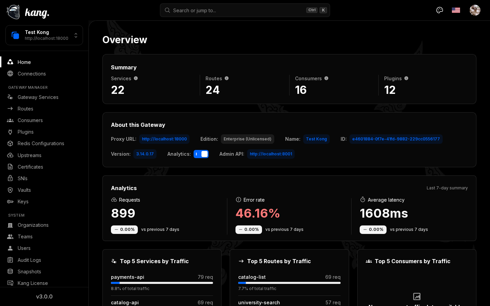
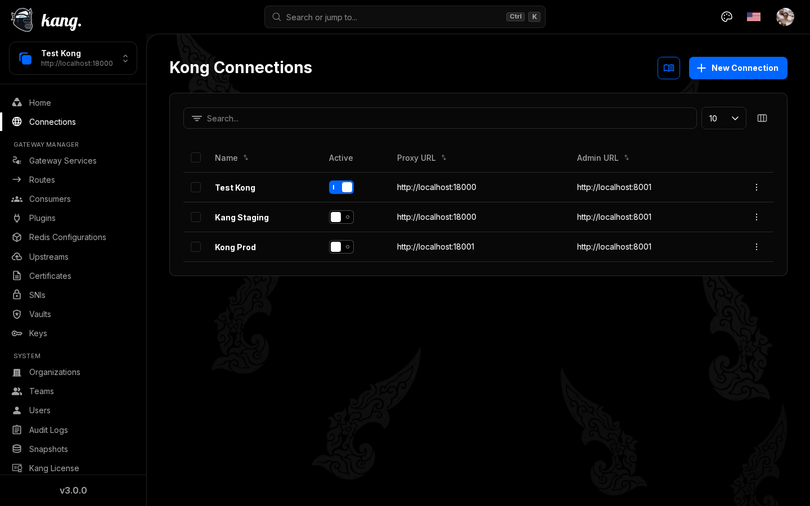

## Navigation

The sidebar groups **Gateway Manager** resources and **System** administration. The connection selector sets the gateway for gateway pages. Your avatar opens account navigation; **Back to workspace** returns from Profile, Preferences, or Security to your workspace.

Use the header's **Search or jump to** control to find available destinations. Each resource list provides its own search and, where supported, filters, sorting, page size, and column visibility. Check active filters if a known resource is missing. Empty results are not necessarily an empty gateway.

## Lists and detail pages

1. Select the intended connection.
2. Open the resource list, search by a relevant value, and select its name to inspect details.
3. Use the row action menu for the operations your permissions allow.
4. For lists with checkboxes, review the selection before a bulk action.

The book button opens contextual help. Required fields have an asterisk, but some requirements are conditional: for example, a consumer needs a username **or** custom ID. Read the validation message instead of filling every optional field.

## Draft recovery

Supported create/edit forms retain non-sensitive draft fields in the current browser tab's session storage. Refreshing that tab can restore those fields. Drafts are separated by user, connection, page, and resource context; they are not saved gateway configuration.

Passwords, tokens, private keys, credential fields, and some plugin configuration fields are deliberately excluded. Re-enter them after refresh. Draft recovery is not guaranteed if browser storage is unavailable, cleared, or the tab session ends. Do not rely on it across devices.

Changing connections while editing prompts you to discard the form. To preserve the current editing context, use **open in new tab** for the other connection. Successful save/discard flows clear the relevant draft.

## Delete carefully

Review the resource name in the confirmation dialog and enter it when requested. Deletion affects the selected gateway or Kang record immediately after success. Deleting a Kang connection is different from deleting Kong resources. Use [snapshots]((/kang//administration/snapshots/) when you need a recoverable gateway configuration before a change.
