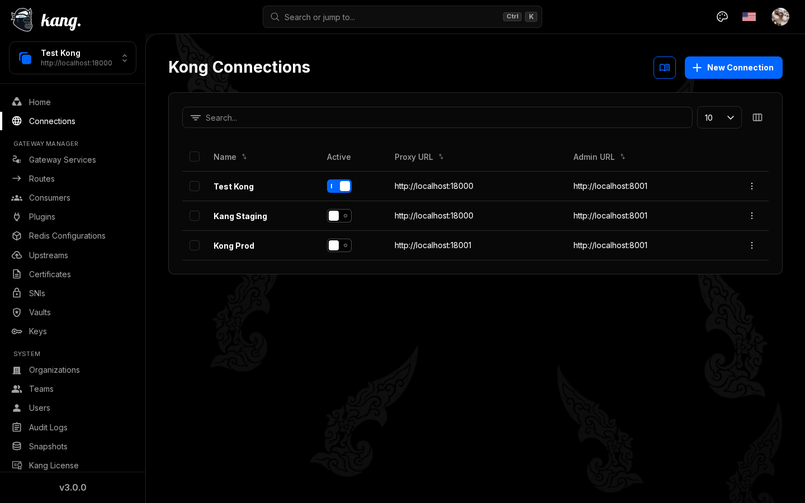

A connection stores the addresses and Admin API authentication for a Kong gateway. Free allows up to **2 connections per Kang installation**, not two per user. Pro removes that plan limit; permissions still apply.

## Add or edit a connection

1. Open **Connections → New Connection**.
2. Enter a distinct name, such as `Staging` or `Production`.
3. Set the proxy URL used for API traffic and the Admin API URL used for management. They usually differ.
4. Choose authentication: **None**, **Kong Admin Token**, **Bearer Token**, **Basic Auth**, **API Key**, or **Custom Header Token**.
5. Supply the fields required by that method. Basic Auth needs a username and password; API Key and custom header authentication need the expected header name. A custom token prefix is optional.
6. Use **Test Connection** and inspect reachability and compatibility feedback.
7. If using Pro with team management permissions, optionally assign teams, then save.

When editing, a blank credential can retain the existing credential when the form indicates that behavior. Changing the authentication method may require a new credential. The saved secret is not displayed back by the API.

## Reachability

The Kang backend must reach the Admin API. `localhost` inside its container means that container, not your host or a different container. Use a reachable DNS name, Kubernetes Service, or shared Docker network. Do not put authentication credentials inside the URL.

## Switch environments without losing context

The sidebar selector supports search, arrow-key navigation, and opening a connection in a new tab. List pages remain on their corresponding list when switching: `/services` stays `/services`. A detail or edit page returns to that resource's list because its ID may not exist in the other gateway.

Each tab has an explicit `instance` in its URL. Open staging and production in different tabs for side-by-side work. Switching while filling a form asks whether to discard it; use the new-tab icon to retain the current form instead.

## Default connection order

The sidebar and Connections table show the active connection first, then sort the other connections by how often you open them. Ties and connections with no history use alphabetical order. The history belongs to your account and follows you across devices. It counts deliberate switches and the **Open in new tab** action, not page refreshes, cancelled switches, or gateway traffic. Table column sorting still overrides the default order for the other connections.

## Share a resource link

Share the deployed application URL including `?instance=...`. The recipient must sign in and have access to that connection and resource type. The URL does not grant permission. `localhost` links refer to the recipient's own computer and are unsuitable for a shared remote installation.

Deleting a connection removes its Kang connection record; it is not a command to uninstall Kong. At the Free quota, adding another connection requires removing an unneeded record or upgrading the installation.
