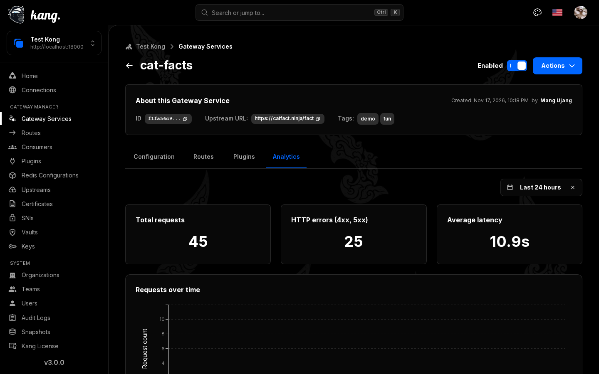

Kang's analytics views are powered by the **Kong prometheus plugin** feeding a **Prometheus-compatible metrics store** that the Kang backend queries. Nothing ships pre-wired: you enable the plugin on Kong, scrape its status endpoint, point the backend at the store, and turn analytics on in the app.

```text
Kong data plane ──status port :8100 /metrics──▶ Prometheus / VictoriaMetrics
                                                        │  PROMETHEUS_URL
                                                        ▼
                                              Kang backend :8080
                                                        │  /api/v1/prometheus/*
                                                        ▼
                                             Kang dashboard (analytics views)
```



## 1. Enable the plugin on Kong

Add the plugin through the Kong Admin API:

```sh
curl -X POST http://localhost:8001/plugins \
  --data name=prometheus \
  --data config.status_code_metrics=true \
  --data config.latency_metrics=true \
  --data config.bandwidth_metrics=true \
  --data config.upstream_health_metrics=true
```

The plugin exposes metrics on Kong's **status listener** (default port `8100`), not on the proxy or admin listener. Make sure it is enabled — with `kong.conf` set `status_listen = 0.0.0.0:8100`, or in Docker/Kubernetes set `KONG_STATUS_LISTEN=0.0.0.0:8100` on the data plane. Verify:

```sh
curl -s http://<kong-data-plane-host>:8100/metrics | head
```

You should see `kong_http_requests_total`, `kong_request_latency_ms_*`, `kong_bandwidth_*`, and related series.

## 2. Run and configure the metrics store

Any Prometheus-compatible query API works. The store must be able to reach Kong's status endpoint.

### VictoriaMetrics (single node, Docker)

> [!IMPORTANT]
> The scrape **job name must match the hostname of the Kang connection's Proxy URL**. Kang derives the PromQL `job` matcher from that hostname (a connection with proxy URL `http://localhost:18000` queries `job="localhost"`; `http://kong-gw.internal:8000` queries `job="kong-gw.internal"`). If the names do not match, the dashboard stays empty even though scraping works.

```sh
cat > vm.yml <<'EOF'
global:
  scrape_interval: 15s
scrape_configs:
  # job_name = the hostname of the Kang connection's Proxy URL
  - job_name: localhost
    static_configs:
      - targets: ["kong-data-plane:8100"]   # reachable hostname or IP of the Kong data plane
EOF

docker run --rm --name victoria-metrics -p 127.0.0.1:9090:9090 \
  --network <network-shared-with-kong> \
  -v "$PWD/vm.yml:/etc/vm.yml:ro" \
  -v victoria-metrics-data:/victoria-metrics-data \
  victoriametrics/victoria-metrics:latest \
  -httpListenAddr=:9090 -storageDataPath=/victoria-metrics-data \
  -promscrape.config=/etc/vm.yml
```

If Kong runs on the host, target `host.docker.internal:8100` (Docker Desktop) or the host IP. Verify scraping:

```sh
curl -s 'http://localhost:9090/api/v1/query?query=kong_http_requests_total{job="localhost"}'
```

### Prometheus

Use the same `scrape_configs` job in `prometheus.yml` and start Prometheus as usual. Long-term storage, retention, and backups of metrics data are outside Kang's scope.

## 3. Point the backend at the store

Set `PROMETHEUS_URL` for the backend process (for example `http://localhost:9090`), then restart it. Optional caches speed up repeated dashboard queries; see [the backend environment reference](https://github.com/zaidanm16/kang-backend/blob/main/.env.example) (`PROMETHEUS_*`).

- **Docker Compose:** set `PROMETHEUS_URL` in `backend.env`. Use the service name of your metrics store instead of `localhost` so containers resolve it.
- **Kubernetes chart:** with `metrics.enabled=true` the bundled VictoriaMetrics Service URL is wired into the backend automatically.

## 4. Turn on analytics in the app

Analytics is a **per-user preference**. Open **Profile → Preferences** (or press **Turn on analytics** on the Overview page). When it is off, Kang skips traffic-metrics requests entirely for faster pages.

## Kubernetes (Helm chart)

The chart can deploy a single-node VictoriaMetrics instance and feed the query URL to the backend:

```yaml
metrics:
  enabled: true
  persistence:
    enabled: true
    size: 20Gi
  scrapeConfig: |
    global:
      scrape_interval: 15s
    scrape_configs:
      - job_name: kong
        static_configs:
          - targets: ["kong-status.my-kong-system.svc:8100"]
```

Kong is not part of the chart, so you must expose its status listener yourself — for example, a `Service` named `kong-status` targeting port `8100` of the Kong data plane pods. `metrics.scrapeConfig` is passed verbatim to the bundled VictoriaMetrics; by default it scrapes nothing. Alternatively set `metrics.externalUrl` (or `metrics.existingSecret`) to an existing Prometheus/VictoriaMetrics. See the [chart README](https://github.com/zaidanm16/kang-deploy/blob/main/charts/kang/README.md).

## What the dashboard shows

With analytics on, the Overview page queries recent windows (default last 7 days) for total requests, error rate, and average latency; per-service, per-route, and per-consumer rankings; and traffic/latency trends over time. Service detail, route detail, and consumer detail pages show their own analytics tabs.

## Troubleshooting

| Symptom | Check |
| --- | --- |
| "Analytics is turned off" on Overview | It is a per-user preference — turn it on in Profile → Preferences. |
| "No data" or empty charts | Is `kong_http_requests_total` present in the store's query API? Is the scrape job `up == 1`? |
| Store returns nothing for Kong queries | The prometheus plugin is not enabled, the status listener is off, or the store cannot reach the status endpoint. |
| Store scrapes, dashboard still empty | `PROMETHEUS_URL` does not point at the store, or the backend cannot resolve it (container vs host addressing). |
| Metrics stop after a Kong restart | Status listener config was lost — re-check `KONG_STATUS_LISTEN` / `status_listen`. |
