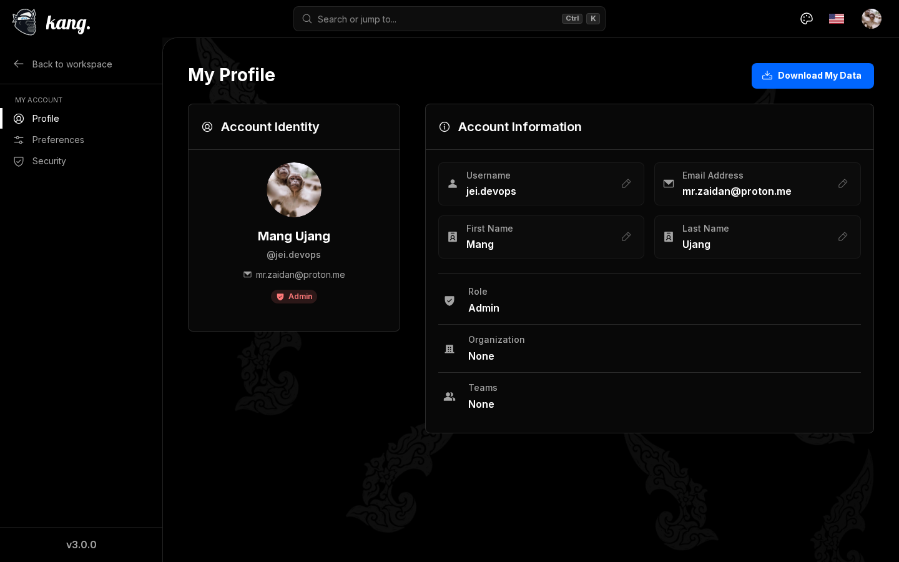

Buka menu avatar lalu **Profile**. Halaman akun memakai sidebar sendiri: Profile, Preferences, dan Security. **Back to workspace** mengembalikan konteks kerja. **Kang License** merupakan halaman System terpisah di `/license`.

## Memperbarui identitas

Gunakan ikon edit di sebelah username, email, nama depan, atau nama belakang untuk membuka editor field, masukkan nilai valid, lalu simpan. Role, organisasi, dan tim merupakan informasi akses; mintalah administrator berwenang untuk mengubahnya.

**Download My Data** mengunduh record pengguna saat ini sebagai JSON. Ini bukan ekspor seluruh audit log, konfigurasi gateway, atau database Kang. Periksa file sebelum membagikan.

## Foto profil

Gunakan kontrol foto untuk mengunggah atau mengganti gambar, crop, lalu simpan. Format yang didukung: **PNG, JPEG, dan WebP**, maksimal **5 MB**. Upload memerlukan konfigurasi Cloudinary di backend. Jika gagal, periksa format/ukuran dan minta operator mengikuti [panduan Cloudinary](/kang/id/guides/operations/#mengaktifkan-upload-foto-dengan-cloudinary), bukan menempel URL gambar privat ke field lain.

Foto tersimpan ditampilkan pada header dan daftar pengguna. Perubahan foto dilakukan sendiri oleh pemilik akun; form pengguna administrator tidak menyediakan editor avatar. Gunakan aksi hapus foto jika tidak ingin menampilkannya lagi.

## Mengganti password

Buka **Security → Change Password**, isi field yang diminta dialog, penuhi kebijakan yang ditampilkan, lalu kirim. Kebijakan dapat dikonfigurasi; form instalasi Anda menjadi acuan. Jangan membagikan password lama atau baru dalam pesan dukungan.

## Sesi aktif

Security menampilkan informasi akun/password dan sesi aktif. Kenali perangkat saat ini, periksa sesi tidak dikenal, lalu gunakan **Revoke** atau **Revoke All Other Sessions** bila diperlukan. Mencabut sesi dan mengganti password memiliki tujuan berbeda; lakukan keduanya bila sesuai dengan insiden akun.

Halaman Security saat ini menampilkan status MFA **Not enabled** dan belum menyediakan alur pendaftaran MFA. Jangan menganggap MFA aktif hanya karena label status tersedia.
