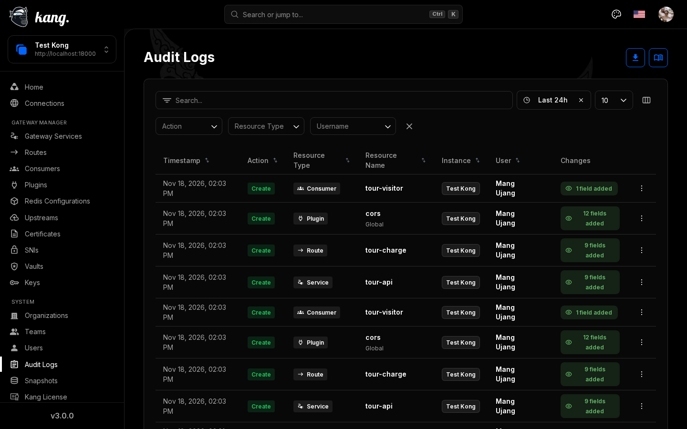

**Audit Logs** merekam aktivitas administrasi di Kang, bukan access log HTTP seluruh request yang melewati Kong. Akses memerlukan akun global dengan izin membaca audit.

## Mencari kejadian

1. Buka Audit Logs.
2. Atur rentang waktu, lalu gunakan pencarian dan filter Action, Resource Type, serta Username sesuai kebutuhan.
3. Baca timestamp, aksi, resource, instance, dan pengguna bersama-sama.
4. Bersihkan filter jika kejadian tidak ditemukan; periksa rentang waktu dan halaman sebelum menyimpulkan record tidak ada.

Untuk plugin berscope, nama resource menyertakan entitas terkait jika tersedia, misalnya `http-log` dengan `Service: catalog`. Ini membedakan instance plugin bernama sama pada resource berbeda. Record lama mungkin belum menyimpan konteks tersebut.

## Memeriksa perubahan

Free menampilkan daftar aktivitas. Pro menyediakan detail perubahan per field melalui kontrol **Changes**. Gunakan untuk memahami penambahan, pembaruan, atau penghapusan; jumlah field saja belum menjelaskan dampaknya. Instance penting ketika nama resource sama pada staging dan production.

Pembatasan Pro diterapkan backend. Mengekspor log bukan cara untuk memperoleh detail perubahan yang disembunyikan pada Free.

## Mengekspor

1. Pilih tombol download/export.
2. Pilih **Current page**, **Timestamp range**, atau **All logs**.
3. Untuk rentang timestamp, isi kedua batas dan pastikan waktu awal tidak melewati akhir. Rentang bersifat inklusif.
4. Pilih **CSV** atau **JSON**, lalu **Export**.

Current page berisi baris yang sedang ditampilkan. Scope lain dapat memuat lebih banyak data daripada halaman tabel saat ini; periksa isi sebelum membagikan. Ekspor besar dapat dibatasi konfigurasi instalasi. Lindungi file karena metadata aktivitas bisa mengungkap pengguna, nama resource, dan detail infrastruktur.
