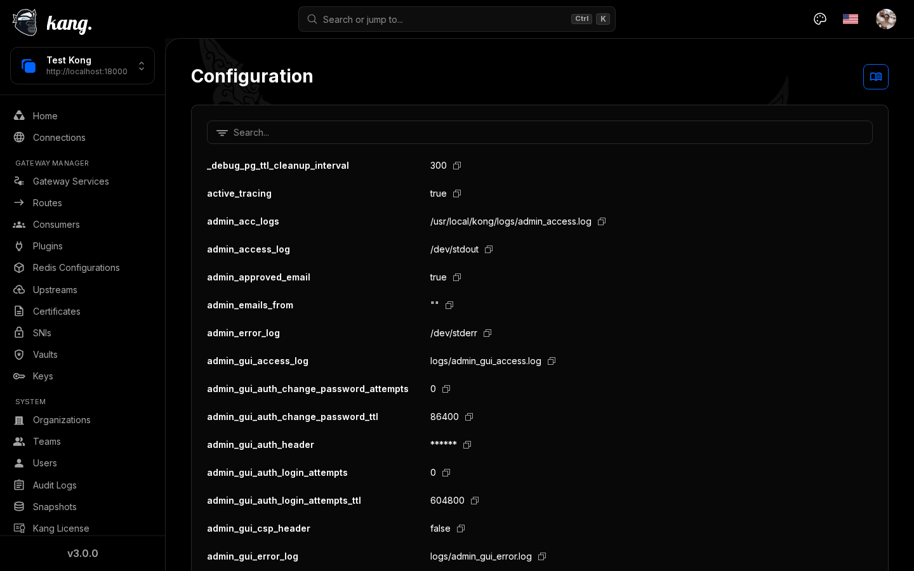

**Configuration** menampilkan konfigurasi runtime node Kong terpilih. Halaman ini membantu memeriksa listener, datastore, direktif Nginx, dan pengaturan plugin yang diekspos Admin API. Ini tampilan baca-saja, bukan editor `kong.conf`.

## Menggunakan halaman

1. Pastikan koneksi terpilih benar.
2. Buka Configuration dan periksa nilai yang relevan.
3. Bandingkan dengan konfigurasi yang diinginkan atau environment lain di tab terpisah.
4. Untuk mengubah pengaturan startup, minta operator Kong memperbarui konfigurasi/environment gateway dan menjalankan prosedur restart atau reload yang sesuai.

Nilai tersebut berbeda dari konfigurasi aplikasi Kang. Database atau listener gateway tidak berubah hanya karena nama koneksinya diganti.

## Tiga persyaratan yang terpisah

| Persyaratan | Contoh |
| --- | --- |
| Paket Kang | Snapshot, tim, dan detail perubahan audit memerlukan Pro |
| Permission dan scope akun Kang | Pengguna harus diizinkan mengedit service dan mengakses koneksinya |
| Dukungan gateway Kong | Plugin, provider vault, atau resource Enterprise harus didukung versi/edisi Kong tersebut |

Seluruh persyaratan terkait harus terpenuhi. Resource nonaktif tidak selalu berarti masalah langganan. Periksa hasil tes/kompatibilitas koneksi dan versi gateway di Overview. Upgrade Kang tidak otomatis meng-upgrade Kong, dan lisensi Kang Pro bukan lisensi Kong Enterprise.

Jika schema gateway menolak field, periksa error field dan dokumentasi versi Kong Anda, bukan mengirim payload yang sama berulang kali. Kredensial Admin API yang dibatasi atau baca-saja bisa mengizinkan inventaris tetapi menolak penulisan.
