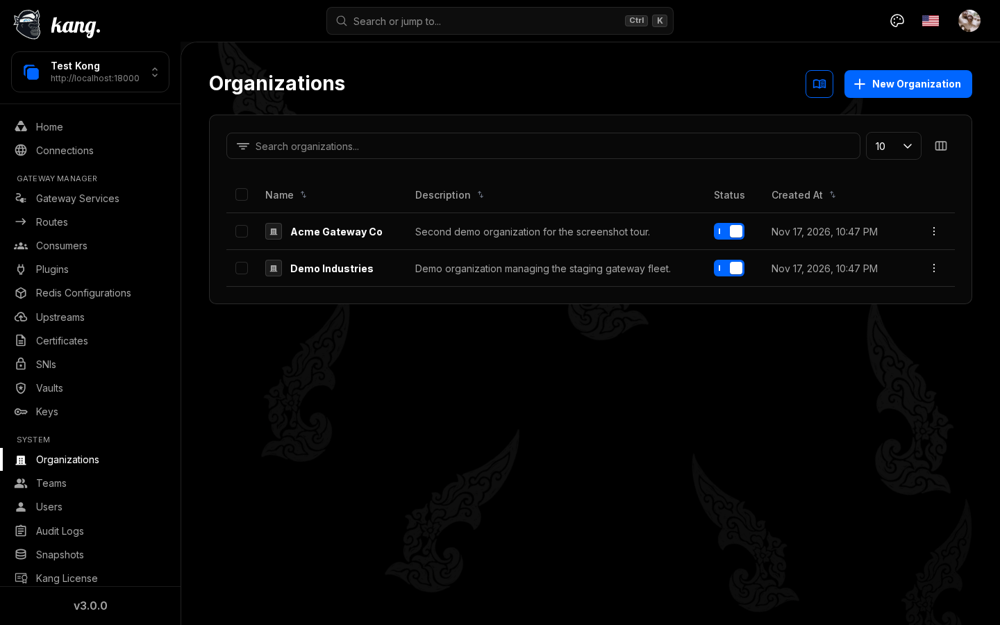
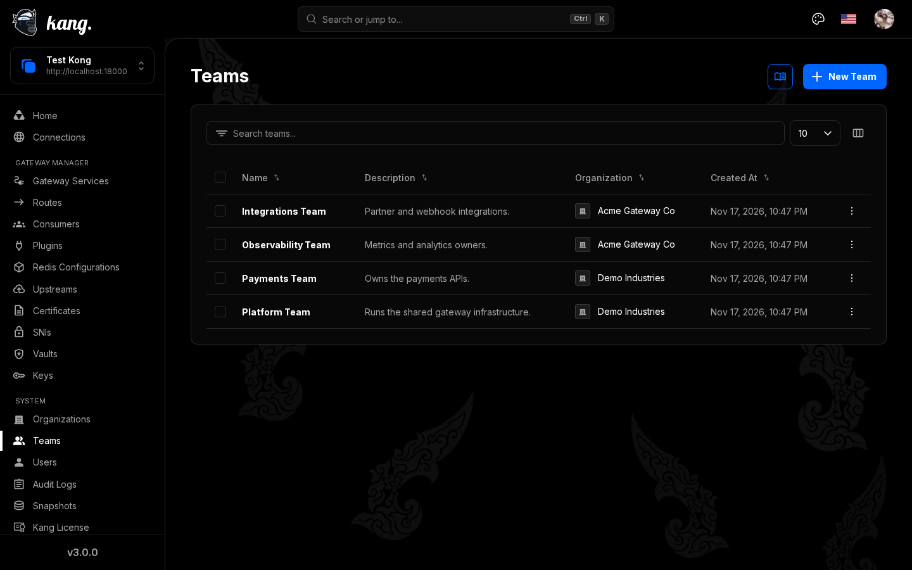

Organisasi dan tim merupakan fitur **Kang Pro**. Keduanya mengelompokkan pengguna dashboard dan akses gateway, bukan consumer atau consumer group Kong.

## Menyiapkan akses secara berurutan

1. Buka **Organizations** dan buat identitas organisasi. Periksa nama, slug, deskripsi opsional, dan pengaturan logo yang tersedia.
2. Buka **Teams** dan buat tim dalam organisasi itu. Organisasi wajib dipilih; buat dahulu jika daftar masih kosong.
3. Tentukan instance Kong tim melalui **Gateway Access**. Anda juga dapat memilih tim saat mengatur koneksi jika memiliki izin terkait.
4. Buat atau edit pengguna, pilih organisasi, lalu tim di dalamnya.
5. Masuk sebagai anggota yang dituju untuk memastikan koneksi dan aksi yang diizinkan sudah benar.

Pilih batas kepemilikan yang jelas. Membuat organisasi saja tidak otomatis memberikan semua anggota akses ke seluruh koneksi. Periksa pemetaan tim ke instance serta keanggotaan pengguna ke tim.

## Permission dan scope

Pembuatan/pengeditan organisasi dan tim memakai izin pengelolaan pengguna; pemetaan gateway juga memerlukan izin instance yang sesuai. Role mengontrol aksi dalam scope yang bisa diakses.

Fitur khusus akun global, termasuk audit log, snapshot, dan administrasi role, tidak terbuka bagi akun berscope organisasi hanya karena instalasi memakai Pro. Hubungi administrator global jika memerlukan alur tersebut.

## Mengubah keanggotaan

Sebelum menghapus pengguna dari tim atau mengganti pemetaan koneksi, tentukan akses mana yang akan hilang. Periksa keanggotaan lain, bukan menganggap satu penghapusan mencabut semua akses gateway. Periksa anggota dan tim terkait sebelum menghapus organisasi; ikuti validasi aplikasi dan jangan mengasumsikan penghapusan berantai.
