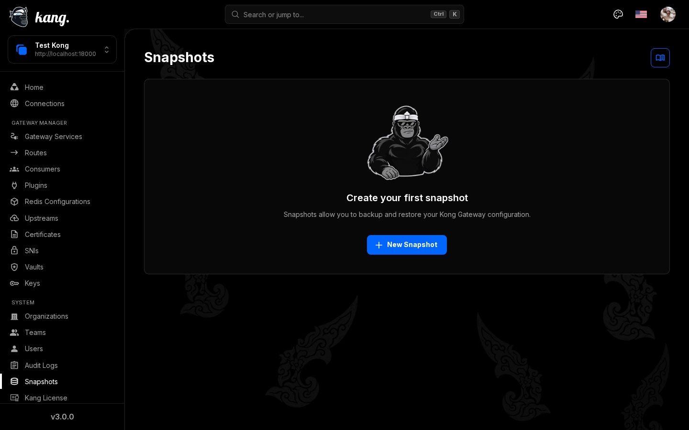

Snapshot menangkap **konfigurasi Kong** yang didukung, bukan seluruh database Kang. Alur Pro ini memerlukan akun global dengan permission snapshot yang sesuai. Restore juga membutuhkan izin menulis resource gateway tujuan.

## Mengambil snapshot

1. Pilih koneksi sumber lalu buka **Snapshots → Create Snapshot**.
2. Pilih **Capture Current**.
3. Isi nama wajib dan deskripsi opsional, misalnya konteks perubahan yang akan dilakukan.
4. Pilih **Capture Snapshot** dan tunggu berhasil. Jika resource wajib gagal dibaca, capture berhenti, bukan diam-diam menghasilkan backup yang tampak lengkap.
5. Periksa metadata/JSON snapshot dan simpan hasil ekspor bila diperlukan.

## Clone atau impor

**Clone Node** membaca konfigurasi dari Admin API lain menggunakan autentikasi pada dialog. Gunakan URL dasar Admin API tanpa kredensial di dalam URL. Kredensial sumber digunakan untuk operasi tersebut dan tidak disimpan sebagai kredensial snapshot. Clone menyimpan snapshot, bukan otomatis menimpa gateway saat ini.

**Import File** menerima **JSON** deklaratif Kong maksimal **10 MB** pada UI upload. File divalidasi sebelum dibuat. YAML bukan format input yang sama. Snapshot dapat memuat konfigurasi gateway sensitif; lindungi file impor/ekspor.

## Restore ke gateway

1. Buka aksi restore snapshot dan pilih **Target Kong Instance** secara eksplisit.
2. Aktifkan **Customize snapshot JSON** bila ingin mengedit salinan sementara. Find/replace tersedia; perubahan ini tidak mengubah snapshot tersimpan.
3. Tinjau dan pilih resource. Periksa dependensi serta kompatibilitas versi target.
4. Mulai restore dan biarkan jendela terbuka selama proses.
5. Jika konflik muncul, periksa resource dan payload. Koreksi field yang diterima lalu retry, atau skip jika sesuai.
6. Periksa semua hasil: berhasil, dilewati, dan gagal. Restore sebagian bukan restore lengkap yang berhasil.

Resource diproses berdasarkan urutan dependensi. ID dan timestamp asli tidak dijamin tetap sama pada restore logis. **Skip Audit Logging**, jika tersedia, sengaja melewatkan audit restore; biarkan nonaktif jika riwayat dibutuhkan.

## Membatalkan dan undo

Cancel menghentikan pekerjaan berikutnya tetapi tidak otomatis membatalkan operasi yang sudah berhasil. Jika **Undo Restore** tersedia dalam sesi restore saat ini, fitur tersebut menghapus resource yang dibuat dan mengembalikan nilai lama resource yang diperbarui dengan urutan dependensi terbalik. Periksa hasil undo: rollback dapat gagal dan bukan transaksi database atomik. Jangan menutup atau me-refresh dialog dengan mengharapkan status undo tetap tersimpan.

Backup target sebelum perubahan penting dan verifikasi perilaku gateway setelahnya. [Full Migration](/kang-deploy/id/administration/migration/) adalah alur maintenance opsional yang terpisah.
