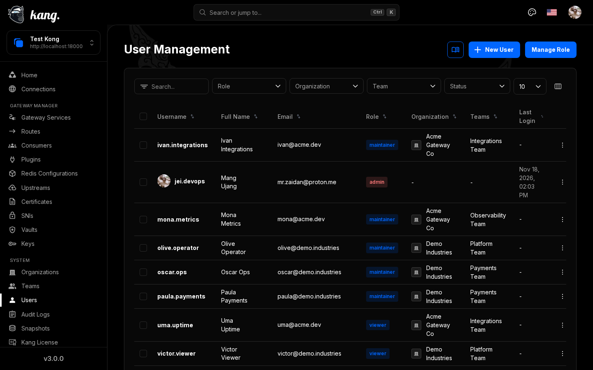

User Kang masuk ke dashboard. Free menyediakan **1 pengguna per instalasi**. Pro mengizinkan pengguna tambahan, tetapi lisensi tidak otomatis memberi seluruh pengguna hak administrator.

## Membuat pengguna

1. Buka **Users → New User** dengan izin membuat pengguna.
2. Isi username unik, password awal, nama depan, nama belakang, dan email. Ikuti kebijakan password di bawah field.
3. Pilih role. Pada Pro, pilih organisasi secara opsional lalu tim dalam organisasi tersebut.
4. Periksa **Enable Account** dan **Force password change on next login**.
5. Simpan lalu berikan detail login kepada pengguna melalui saluran privat.

Tim dipilih setelah organisasi karena keanggotaannya berada di organisasi tersebut. Akun dengan scope organisasi berbeda dari akun global tanpa organisasi.

## Mengedit dan mengelola status

Buka aksi edit pengguna untuk mengubah identitas dan akses yang didukung. Saat mengedit, biarkan **New Password** kosong untuk mempertahankan password lama. Jika mereset, ikuti kebijakan saat ini dan pertimbangkan mewajibkan penggantian saat login berikutnya.

Gunakan aksi activate/deactivate atau unlock sesuai kondisi dan izin. Deactivation menonaktifkan akun; unlock membuka kunci login. Keduanya berbeda dari menghapus pengguna. Periksa pengelolaan sesi saat mencabut akses perangkat yang bermasalah.

Foto profil yang tersedia ditampilkan sebelum username di daftar; akun tanpa foto tidak perlu memiliki gambar. Pengelolaan foto dilakukan pengguna melalui Profile sendiri, bukan field avatar pada form create/edit administrator.

## Mengelola role

Buka **Manage Role** dari User Management. Matriks permission menampilkan aksi per resource dan role. Dengan izin memperbarui konfigurasi, edit permission, periksa pengguna yang terdampak, lalu simpan. Pembuatan custom role memerlukan kode dan nama role. Permission role `admin` tidak diedit seperti role biasa.

Izin menentukan aksi; keanggotaan organisasi dan tim dapat membatasi cakupannya. Administrasi role memerlukan izin konfigurasi dan mengikuti [aturan akses platform](/kang/id/administration/organizations-teams/#permission-dan-scope). Jika pengguna dapat melihat resource tetapi tidak menyimpan, periksa izin update/create sebelum mengganti organisasinya.

## Pulihkan akses administrator

Jika administrator lain masih bisa masuk, minta dia memeriksa status akun, membuka kunci atau mengaktifkan akun jika perlu, dan mereset password bila diperlukan. Jika tidak ada admin yang bisa masuk, ikuti prosedur pemulihan privat milik operator. Backup database terlebih dahulu, pastikan targetnya database Kang, lalu verifikasi login dan cabut sesi yang tidak diinginkan setelah pemulihan. Token setup awal bukan mekanisme reset password.
