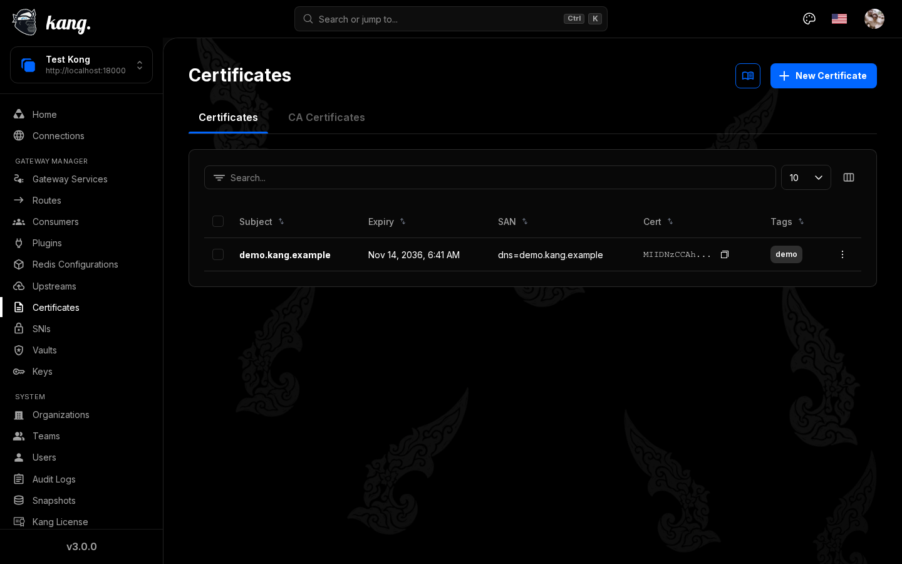

Gunakan **Certificates** untuk certificate server dan CA certificate, serta **SNIs** untuk menghubungkan hostname dengan certificate server. Resource ini mengatur TLS gateway, bukan certificate website Kang itu sendiri.

## Certificate server

1. Buka Certificates dan pilih aksi membuat certificate server.
2. Tempel certificate serta private key pasangannya pada field PEM yang sesuai. Isi certificate/key alternatif hanya jika diperlukan dan didukung.
3. Tambahkan tag opsional, simpan, lalu periksa record.
4. Hubungkan hostname SNI yang sesuai dengan certificate tersebut.

Pastikan certificate chain valid dan private key cocok. Field PEM/private key sensitif tidak dipulihkan dari draft browser; simpan sumbernya dengan aman sampai berhasil disimpan.

## CA certificate

Buka bagian CA certificate dan masukkan PEM CA certificate serta tag opsional. CA certificate merupakan material trust; penggunaannya bergantung pada pengaturan TLS service/plugin. Mengunggah CA tidak otomatis mengaktifkan mutual TLS atau memasangnya pada semua service.

## Pemetaan SNI

Buat SNI dengan hostname yang diminta lalu pilih certificate server yang direferensikan. Periksa hubungan certificate sebelum menyimpan. Uji TLS menggunakan hostname sebenarnya: koneksi dengan IP saja mungkin tidak mengirim SNI yang diharapkan.

## Rotasi dan penghapusan

Siapkan certificate dan key pengganti, perbarui pemetaan atau record terkait, lalu uji koneksi TLS hostname serta masa berlakunya. Periksa referensi sebelum menghapus. Error TLS browser pada dashboard Kang bisa berasal dari reverse proxy Kang; mengedit certificate Kong tidak otomatis memperbaikinya.
