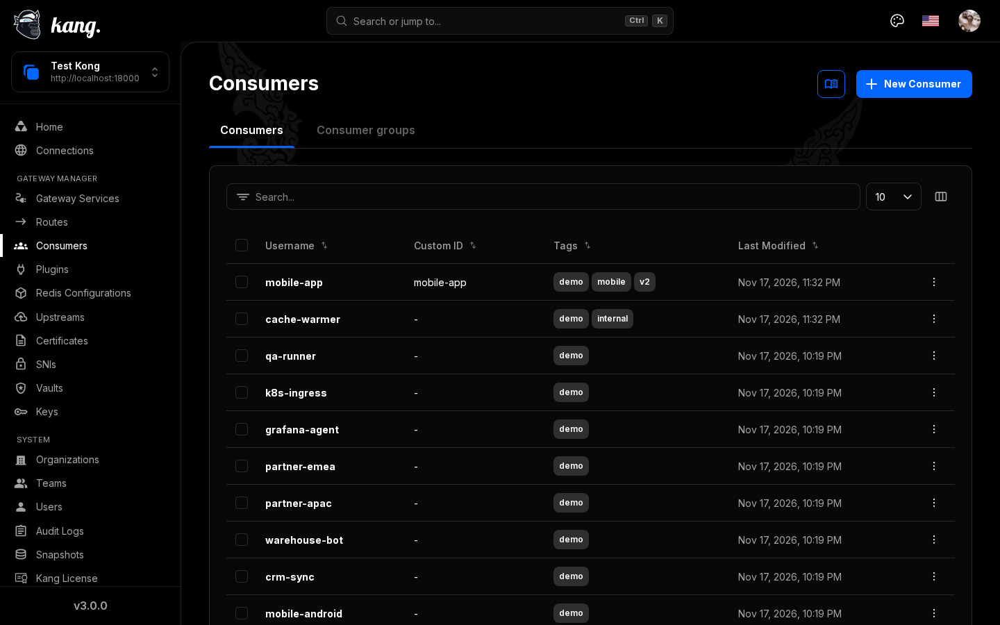
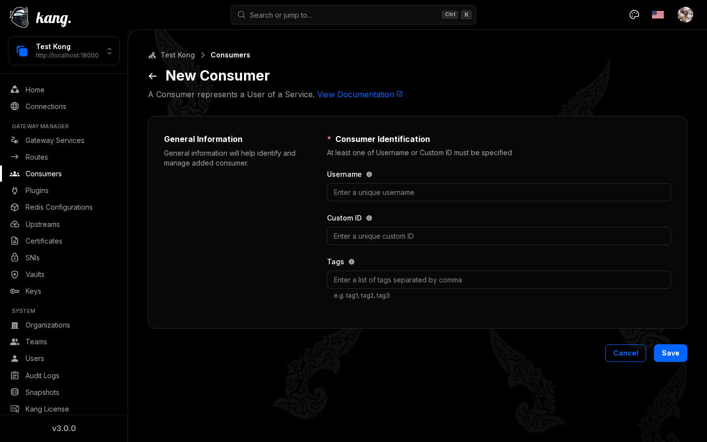

Consumer mewakili klien API Anda, bukan akun login Kang. Akun dashboard dikelola melalui **Users**.

## Membuat consumer

1. Buka **Consumers** dan pilih aksi membuat consumer.
2. Isi **Username**, **Custom ID**, atau keduanya. Minimal salah satu wajib; masing-masing tidak wajib sendiri jika yang lain sudah diisi.
3. Tambahkan tag opsional lalu simpan.
4. Buka detail consumer untuk mengelola kredensial dan plugin berscope consumer.

Gunakan custom ID jika menghubungkan consumer dengan identitas pada aplikasi Anda. Jangan mengubah identifier tanpa memeriksa integrasi yang bergantung padanya.

## Menambahkan kredensial

Buka bagian kredensial terkait lalu buat kredensial untuk plugin autentikasi yang digunakan. Form mendukung entri ACL, Basic Authentication, Key Authentication, HMAC Authentication, dan JWT.

- **ACL:** isi grup yang digunakan kebijakan ACL terkait.
- **Basic Auth:** masukkan username dan password.
- **Key Auth:** buat atau isi key sesuai dukungan form/gateway.
- **HMAC Auth:** atur username dan secret yang dibutuhkan.
- **JWT:** pilih algoritma dan isi key/secret atau public key yang diwajibkan. Algoritma menentukan material yang dibutuhkan.

Aktifkan plugin autentikasi yang sesuai pada service, route, scope consumer jika didukung, atau global sesuai kebutuhan. Membuat kredensial saja tidak membuat route publik mewajibkan autentikasi. Simpan secret dengan aman dan isi ulang field sensitif setelah refresh form bila diperlukan.

## Consumer group

Jika gateway mendukung, buka **Consumer Groups**, buat grup, tambahkan consumer, lalu atur plugin grup yang tersedia. Periksa keanggotaan sebelum mengubah kebijakan bersama. Consumer group adalah resource Kong, berbeda dari **Teams** di Kang.

## Verifikasi dan penghapusan

Uji request dengan dan tanpa kredensial melalui proxy gateway. Pastikan kebijakan menghasilkan respons yang diharapkan. Menghapus kredensial dapat langsung membuat klien gagal autentikasi. Lakukan rotasi terkoordinasi: siapkan pengganti, perbarui klien, verifikasi, lalu hapus kredensial lama.
