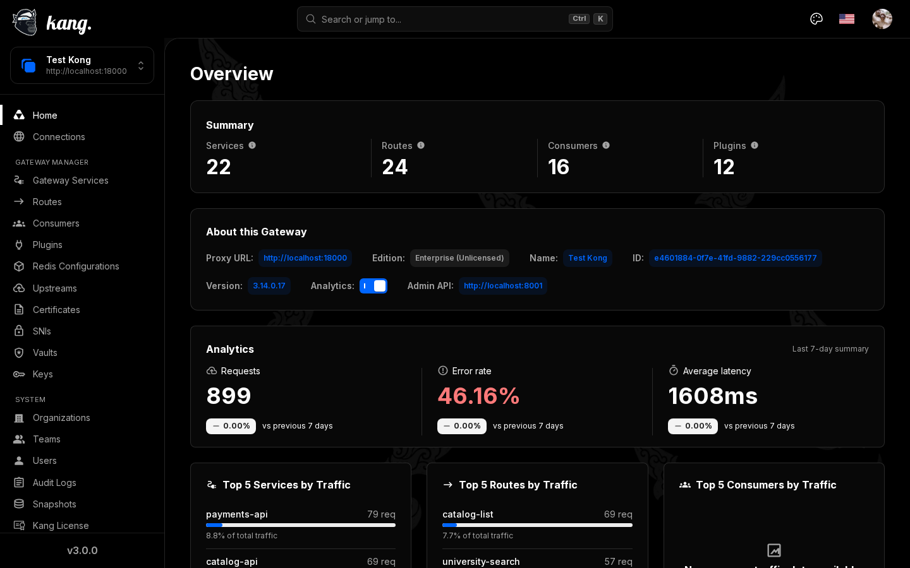

Buka **Home** setelah memilih koneksi. Jumlah resource merangkum service, route, consumer, dan plugin gateway terpilih. **About this Gateway** menampilkan informasi koneksi, versi/edisi gateway, proxy URL, dan Admin API URL.

## Mengaktifkan atau mematikan analitik

Gunakan kontrol analitik di Overview atau **Profile → Preferences → Analytics**. Saat dimatikan, Kang tidak meminta metrik trafik tetapi tetap menampilkan inventaris konfigurasi. Mengaktifkan analitik hanya mengubah preferensi, bukan memasang atau mengonfigurasi server metrik.

Operator harus mengatur query API yang kompatibel dengan Prometheus, melakukan scrape metrik gateway, dan memastikan metrik gateway terpilih dapat diidentifikasi. Ketersediaan metrik bergantung pada instalasi. Jumlah resource bisa tampil normal meskipun grafik trafik gagal dimuat.

## Membaca grafik

Pilih rentang waktu yang tersedia, lalu periksa trafik, latensi, dan error bersama-sama. Grafik kosong bisa berarti tidak ada request pada interval tersebut, metrik belum tersedia, atau ada masalah pengumpulan/query. Ini bukan bukti gateway mati. Kirim request uji melalui proxy dan periksa interval sebelum melaporkan masalah.

Preferensi analitik mengontrol permintaan metrik, bukan pemrosesan trafik Kong. Jika halaman terasa lambat dan Anda hanya membutuhkan pengelolaan konfigurasi, matikan analitik lalu coba kembali.

## Konfigurasi dan penggunaan

Distribusi plugin atau jumlah resource menggambarkan objek yang dikonfigurasi. Grafik request rate dan latensi menggambarkan trafik yang diamati. Membuat service tidak otomatis menghasilkan trafik. Selalu pastikan koneksi terpilih saat membandingkan environment.
