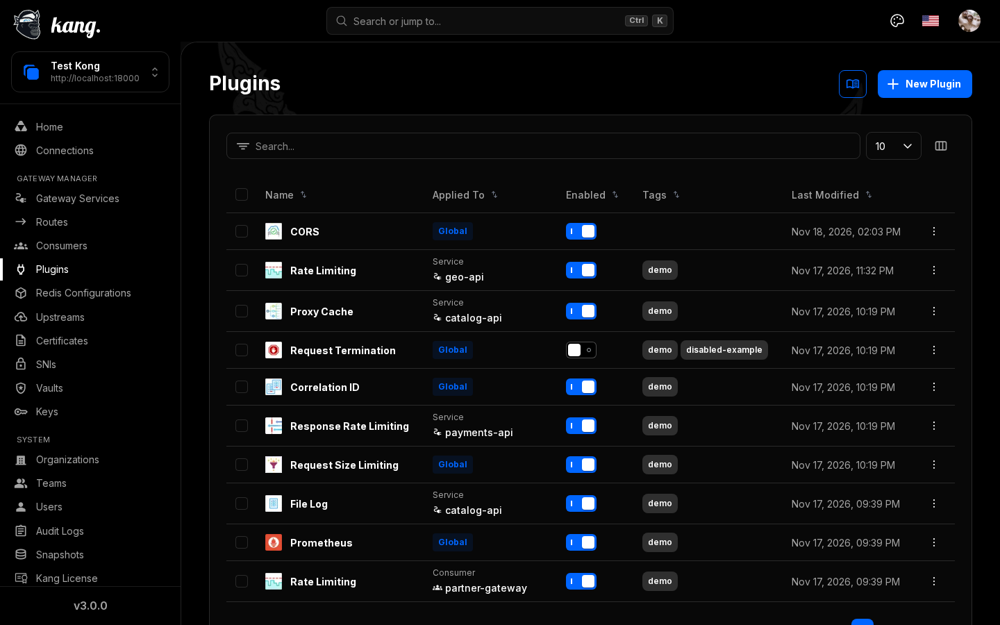
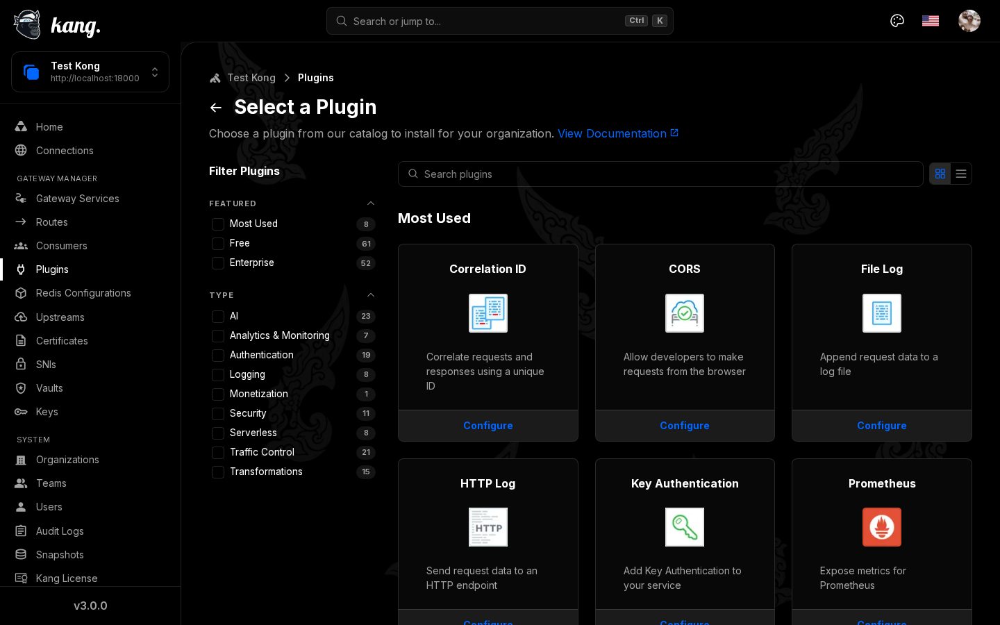

Plugin menambahkan autentikasi, kontrol trafik, transformasi, logging, dan perilaku lain. Ketersediaan serta konfigurasinya mengikuti gateway Kong terhubung, bukan hanya katalog Kang.

## Menambah plugin

1. Pilih koneksi yang benar.
2. Buka **Plugins** atau tab Plugins pada service, route, consumer, atau consumer group yang didukung.
3. Pilih plugin yang tersedia di gateway tersebut.
4. Periksa scope sebelum mengisi konfigurasi. Misalnya, `http-log` berscope service harus menunjuk service yang dimaksud.
5. Isi field schema wajib, periksa protokol/status aktif serta tag opsional, lalu simpan.
6. Kirim request yang mewakili penggunaan sebenarnya melalui proxy dan periksa efek plugin.

## Memahami Applied To

Kolom **Applied To** membedakan plugin global dan berscope. Plugin global dapat memengaruhi trafik seluruh gateway. Plugin berscope terkait dengan resource yang ditampilkan; kombinasi scope yang didukung bergantung pada schema plugin.

Beberapa instance dapat memiliki nama plugin yang sama tetapi target berbeda. Sebelum mengedit atau menghapus `http-log`, periksa **Applied To**, bukan hanya nama. Audit perubahan plugin berscope juga menampilkan konteks entitas jika tersedia.

## Mengedit konfigurasi

Gunakan form untuk plugin terpilih. Field wajib dan tipe nilai berbeda-beda: angka, boolean, array, dan object tidak dapat dipertukarkan. Ikuti validasi serta error gateway. Secret dan konfigurasi plugin dapat dikecualikan dari draft browser, jadi periksa field sensitif setelah refresh.

Menonaktifkan plugin mengubah penerapan kebijakan tanpa harus menghapus konfigurasi tersimpan. Menghapusnya menghilangkan instance konfigurasi tersebut; kedua tindakan ini tidak meng-uninstall kode plugin dari Kong.

## Jika plugin tidak tersedia

Periksa versi gateway, edisi, plugin yang terpasang, serta izin akun mengelola plugin. Upgrade Kang Pro tidak memasang plugin Kong atau membuka lisensi Kong Enterprise. Gunakan tautan dokumentasi plugin untuk pengaturan yang sesuai dengan versi gateway Anda.
