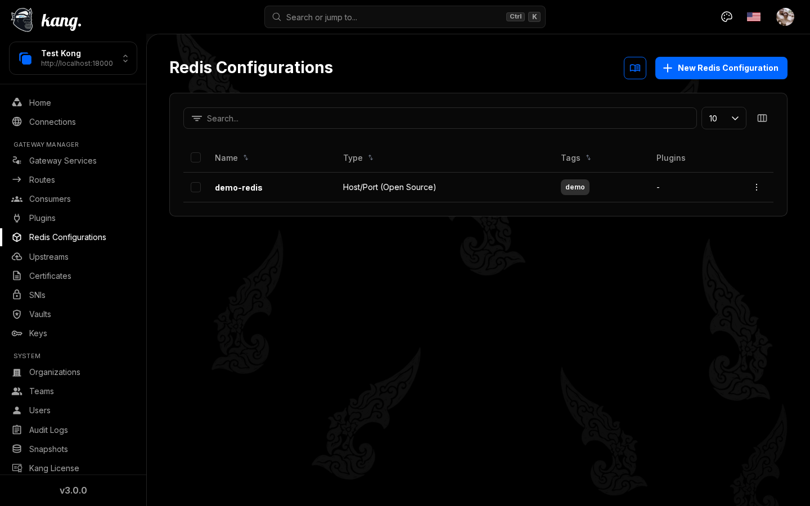

**Redis Configurations** menyimpan pengaturan koneksi Redis yang dapat digunakan ulang oleh plugin Kong yang kompatibel. Fitur ini tidak memasang server Redis atau mengatur database penyimpanan user Kang.

## Membuat konfigurasi

1. Pilih gateway lalu buka Redis Configurations.
2. Pilih tipe yang didukung gateway/plugin: form menyediakan Open Source Host/Port sederhana, Enterprise Host/Port, Cluster, dan Sentinel.
3. Isi host/port atau alamat node yang wajib. Untuk Sentinel, periksa pengaturan master dan role yang tersedia pada form.
4. Atur autentikasi, database, TLS, timeout, serta field lain yang berlaku.
5. Simpan, referensikan dari plugin yang mendukung, lalu uji plugin dengan trafik sebenarnya.

Kong, bukan browser, yang terhubung ke Redis. Pastikan DNS, firewall, kredensial, dan persyaratan TLS cocok. Beberapa layanan Redis menyediakan endpoint HTTP dan protokol Redis; gunakan protokol yang didukung plugin Kong.

## Dukungan fitur

Varian Enterprise memerlukan dukungan Kong yang sesuai. Kang Pro tidak memberikan lisensi tersebut. Konfigurasi reusable tidak otomatis terpasang pada semua plugin: periksa konfigurasi plugin dan mekanisme referensi yang didukung.

## Mengubah atau menghapus

Periksa seluruh plugin yang berbagi konfigurasi sebelum mengubah kredensial, node, atau TLS. Satu perubahan bersama dapat memengaruhi rate limiting, cache, atau kebijakan lain pada beberapa resource. Isi ulang secret setelah refresh jika diminta; draft browser sengaja mengecualikan field sensitif.
