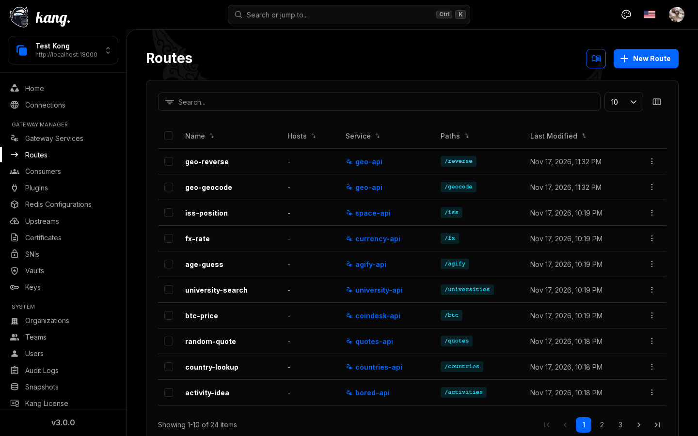
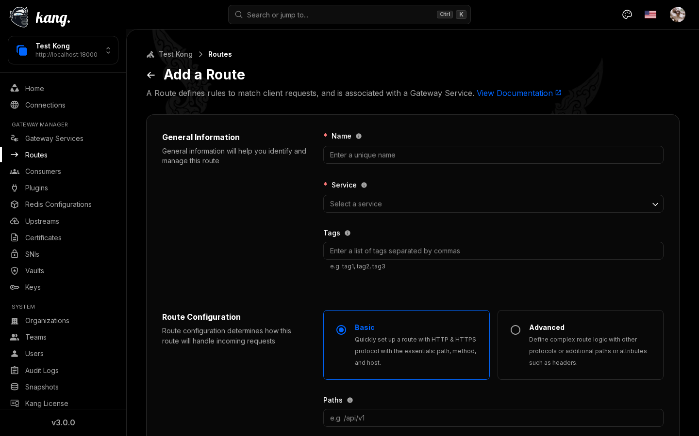

Route mencocokkan request masuk dan menghubungkannya dengan service atau perilaku gateway yang didukung. Buka **Routes**, pastikan koneksi benar, lalu pilih aksi membuat route.

## Mengatur pencocokan

Beri nama yang mudah dikenali, pilih service jika meneruskan request ke upstream, lalu tentukan protokol. Untuk route HTTP sederhana, mulai dari path dan service, kemudian tambahkan pembatasan secara sengaja.

| Field | Kegunaan |
| --- | --- |
| Protocols | Keluarga protokol yang diterima; keluarga yang tidak kompatibel tidak selalu dapat digabung |
| Methods | Membatasi metode HTTP seperti GET atau POST |
| Paths | Mencocokkan path request, misalnya `/catalog` |
| Hosts | Mencocokkan hostname yang diminta klien |
| Headers | Menambahkan kondisi pencocokan header |
| Sources / Destinations | Kondisi IP/CIDR dan/atau port untuk protokol yang mendukung; tiap entri memerlukan IP atau port |
| SNIs | Mencocokkan nama server TLS pada protokol yang mendukung |

Tidak setiap matcher berlaku untuk setiap protokol. Validasi mengikuti schema Kong terpilih. Nama route dan pilihan service tidak menggantikan kebutuhan kondisi pencocokan yang valid.

## Perilaku penerusan

**Strip Path** membuang awalan path yang cocok sebelum diteruskan. **Preserve Host** menentukan apakah header host asli dipertahankan. Periksa buffering request/respons, regex priority, dan status redirect HTTPS hanya sesuai kebutuhan route.

Simpan dan periksa konfigurasi. Uji melalui proxy dengan metode, path, hostname, dan header yang sama dengan klien sebenarnya. Menguji Admin API tidak menguji pencocokan route.

## Mengedit atau menghapus

Perubahan route dapat langsung mengubah tujuan trafik klien. Periksa service dan plugin terkait sebelum menyimpan. Hapus hanya route yang dimaksud dan baca konfirmasinya; menghapus route tidak selalu menghapus service. Jika request tidak lagi cocok, periksa kondisi host/metode/header yang terlalu ketat atau koneksi yang keliru.
