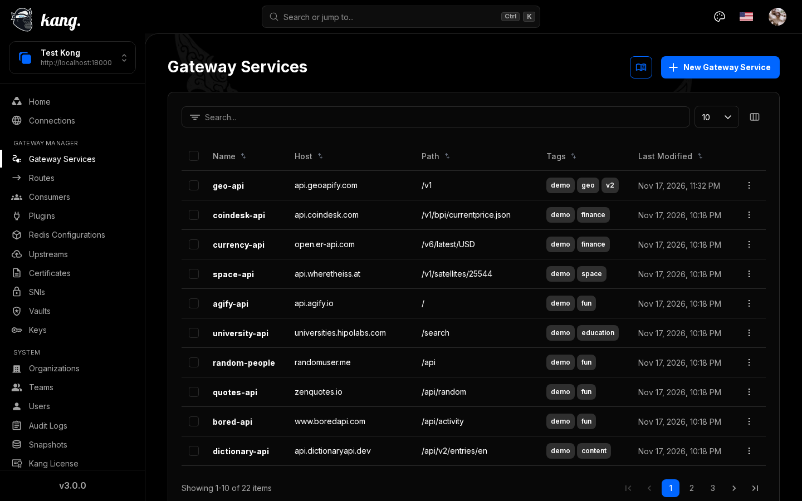
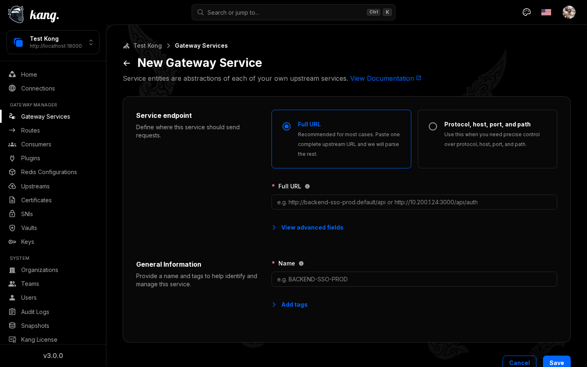

Service mendeskripsikan aplikasi upstream yang dapat menerima request dari Kong. Route menentukan request mana yang diteruskan ke service tersebut. Buka **Gateway Services** pada koneksi terpilih.

## Membuat service

1. Pilih **New Gateway Service** dan masukkan nama deskriptif jika ingin mengenalinya berdasarkan nama.
2. Pilih mode full URL atau field upstream terpisah.
3. Pada full URL, masukkan protocol, hostname, port opsional, dan path dalam satu alamat. Pada field terpisah, isi **Protocol**, **Host**, dan **Port**, ditambah **Path** opsional.
4. Periksa pengaturan lanjutan, tag, dan status aktif service.
5. Simpan, lalu buat atau periksa route-nya. Service tanpa route yang cocok tidak dapat diakses melalui request proxy biasa.

## Pengaturan koneksi

| Pengaturan | Yang perlu diperiksa |
| --- | --- |
| Host | Bisa dijangkau dari Kong; gunakan nama objek upstream jika memakai load balancing upstream tersebut |
| Port | Port aplikasi yang benar-benar mendengarkan request |
| Path | Path dasar yang ditambahkan Kong saat meneruskan request |
| Retries | Jumlah percobaan ulang berdasarkan aturan gateway Kong |
| Connection timeout | Batas waktu membuat koneksi upstream, dalam milidetik |
| Write timeout | Batas waktu menulis request upstream, dalam milidetik |
| Read timeout | Batas waktu membaca respons upstream, dalam milidetik |
| Tags | Label pengelompokan resource; bukan pemberian izin akses |

Validasi schema mengikuti gateway terhubung. Jangan menganggap seluruh kombinasi protokol atau field tersedia pada semua versi.

## Mengubah service

Buka detail, periksa konfigurasi serta route/plugin terkait, lalu edit pengaturan yang diperlukan. Perubahan service bersama dapat memengaruhi seluruh route yang mereferensikannya. Gunakan plugin berscope service untuk kebijakan yang mengikuti service tersebut dan periksa **Applied To**.

## Menelusuri error upstream

Jika koneksi gagal atau muncul 502/504, periksa DNS, port, jaringan, protocol/TLS, dan kesehatan upstream dari lingkungan Kong. Backend Kang yang bisa menjangkau Admin API tidak membuktikan Kong dapat menjangkau aplikasi Anda. Jangan langsung memperbesar timeout sebelum mengetahui penyebab upstream lambat.
