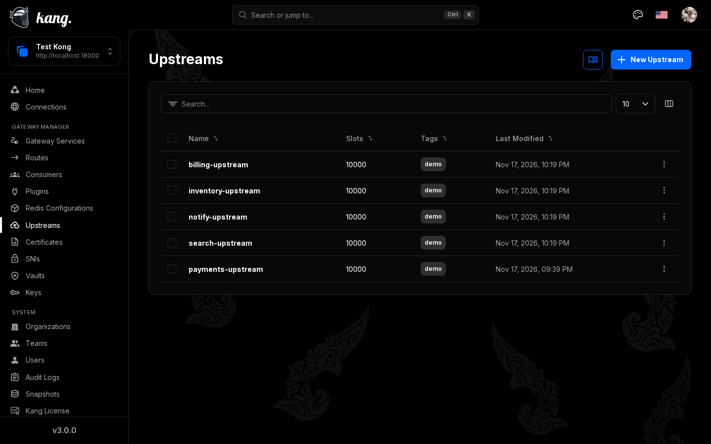

Upstream adalah kumpulan target backend dengan sebuah nama. Service dapat memakai nama tersebut sebagai host agar Kong membagi trafik ke target di dalamnya.

## Membuat kumpulan target

1. Buka **Upstreams** dan buat upstream dengan nama yang jelas.
2. Pilih algoritma balancing yang didukung dan periksa opsi seperti slots serta host header.
3. Simpan, lalu buka bagian **Targets**.
4. Tambahkan alamat dan port target yang dapat dijangkau beserta weight yang diinginkan. Ulangi untuk instance aplikasi lain.
5. Arahkan host service ke nama upstream, lalu uji request melalui route-nya.

Upstream tanpa target yang dapat digunakan tidak bisa melayani trafik. Alamat target harus bisa dijangkau Kong. Menambahkan target pada konfigurasi gateway tidak melakukan deployment aplikasi target tersebut.

## Health check

Health check aktif mengirim probe ke target; health check pasif bereaksi terhadap hasil request yang diamati. Atur protokol, interval, timeout, concurrency, status HTTP sehat/tidak sehat, serta threshold yang tersedia di form. Untuk HTTP, gunakan endpoint yang menunjukkan readiness, bukan route sembarang yang selalu gagal.

Periksa konfigurasi dan status target sebelum memaksakan status sehat/tidak sehat. Endpoint readiness yang berhasil tidak menjamin seluruh operasi aplikasi berjalan normal.

## Mengubah kapasitas

Tambahkan dan verifikasi target baru sebelum menghapus target lama. Periksa weight dan kesehatan untuk memahami pembagian trafik. Jika request gagal setelah perubahan, periksa host service, nama upstream, port target, DNS, dan health check. Menghapus upstream yang digunakan service dapat mengganggu routing; ubah referensinya terlebih dahulu.
