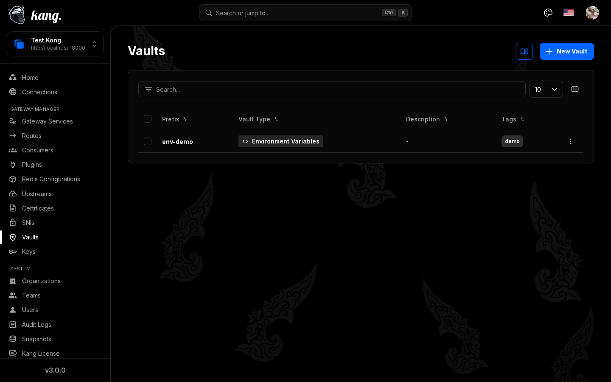

Entitas vault Kong mengatur cara Kong membaca referensi secret dari sumber eksternal. Vault tidak menjadikan Kang sebagai secret manager dan tidak otomatis mengunggah secret Anda.

## Mengonfigurasi vault

1. Buka **Vaults** pada koneksi terpilih dan buat vault.
2. Pilih backend yang didukung gateway. Form Kang mencakup Environment, AWS, GCP, HashiCorp Vault, Azure, dan Conjur.
3. Isi prefix referensi unik serta konfigurasi provider yang diminta.
4. Lengkapi lokasi, autentikasi, atau pengaturan khusus provider, lalu simpan.
5. Gunakan referensi vault hanya pada field Kong yang mendukung secret reference. Verifikasi pembacaan secret dari runtime Kong.

Untuk provider environment, secret harus tersedia di environment Kong, bukan hanya backend Kang. Untuk secret manager eksternal, Kong memerlukan jaringan dan izin provider untuk membaca secret yang dituju.

## Pemecahan masalah

Definisi vault yang tersimpan belum membuktikan secret bisa dibaca. Periksa prefix, path/key secret, izin provider, dan pengaturan jaringan/TLS. Opsi backend dan field wajib berbeda menurut versi dan edisi Kong. Jika gateway menolak provider, periksa kompatibilitas, bukan langsung mengganti paket Kang.

## Pengeditan dan penghapusan

Periksa resource yang menggunakan prefix sebelum mengubahnya atau menghapus vault. Referensi yang gagal dibaca dapat membuat konfigurasi terkait tidak berfungsi. Konfigurasi provider sensitif mungkin tidak bertahan setelah refresh; isi ulang jika form memerlukannya.
