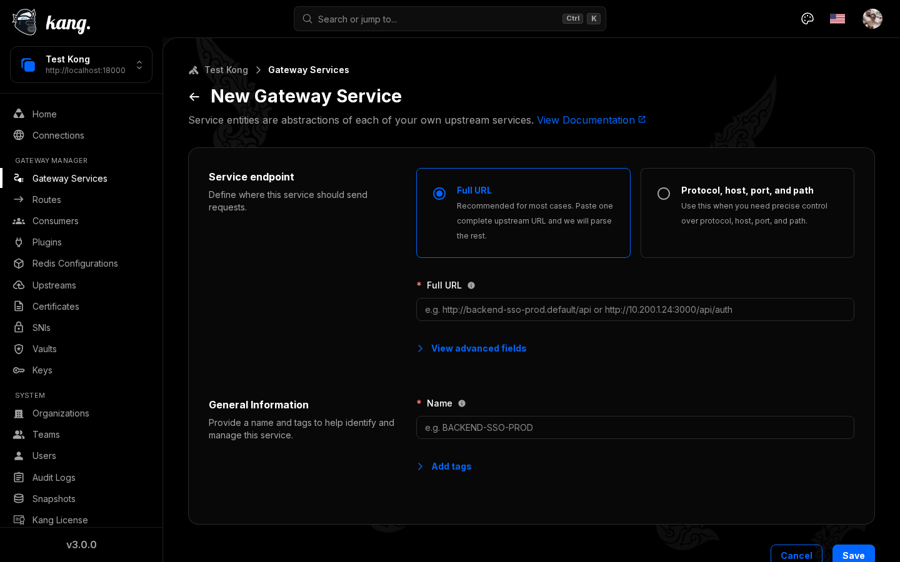
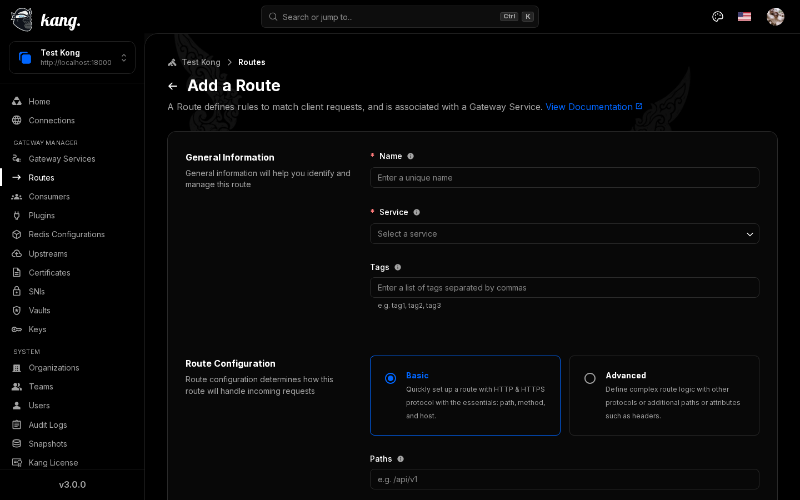

Contoh ini mengekspos aplikasi HTTP yang sudah berjalan melalui Kong. Gunakan gateway uji terlebih dahulu dan ganti alamat contoh dengan alamat Anda. Akun memerlukan izin membuat service dan route.

## 1. Buat service



1. Pilih koneksi uji dan buka **Gateway Services**.
2. Pilih **New Gateway Service**, lalu beri nama yang mudah dikenali, misalnya `catalog`.
3. Pada mode URL, masukkan upstream seperti `http://catalog.internal:8080`. Alternatifnya, isi protocol, host, port, dan path opsional secara terpisah.
4. Simpan dan periksa konfigurasi service. Hostname upstream harus bisa di-resolve dari Kong, bukan hanya dari laptop Anda.

## 2. Buat route



1. Buka **Routes** dan pilih aksi membuat route.
2. Beri nama seperti `catalog-api`, pilih service `catalog`, lalu gunakan protokol HTTP/HTTPS yang sesuai dengan gateway.
3. Tambahkan `/catalog` pada **Paths**. Tambahkan kondisi lain hanya jika ingin mempersempit pencocokan.
4. Periksa **Strip Path**: saat aktif, awalan path route dibuang sebelum request diteruskan. Ini penting jika upstream mengharapkan `/items`, bukan `/catalog/items`.
5. Simpan dan pastikan referensi service benar.

## 3. Kirim request melalui proxy

Gunakan **proxy URL**, bukan Admin API URL. Untuk proxy lokal di port 8000:

```sh
curl -i http://localhost:8000/catalog/items
```

Ganti alamat dan path upstream sesuai lingkungan Anda. Jika route juga mencocokkan host, kirim header `Host` yang sesuai. Respons bergantung pada aplikasi upstream dan plugin yang aktif.

## 4. Tambahkan kebijakan

Buka tab **Plugins** milik service atau route dan tambahkan plugin yang tersedia. Periksa **Applied To** sebelum menyimpan agar kebijakan diterapkan ke resource yang benar. Untuk autentikasi, buat [consumer dan kredensial]((/kang//id/gateway/consumers/) lalu aktifkan plugin terkait; consumer saja tidak mewajibkan autentikasi.

Jika request gagal, baca [pemecahan masalah]((/kang//id/guides/troubleshooting/) dan periksa koneksi terpilih sebelum mengubah konfigurasi lain.
