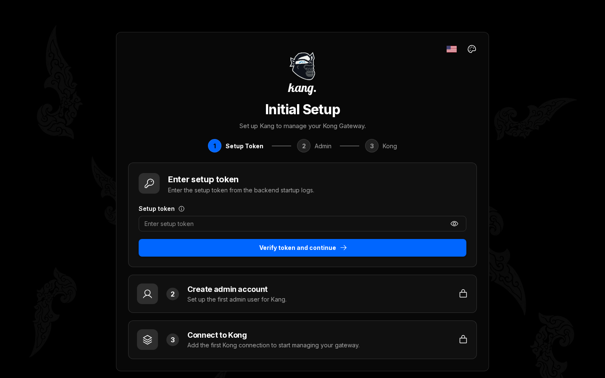
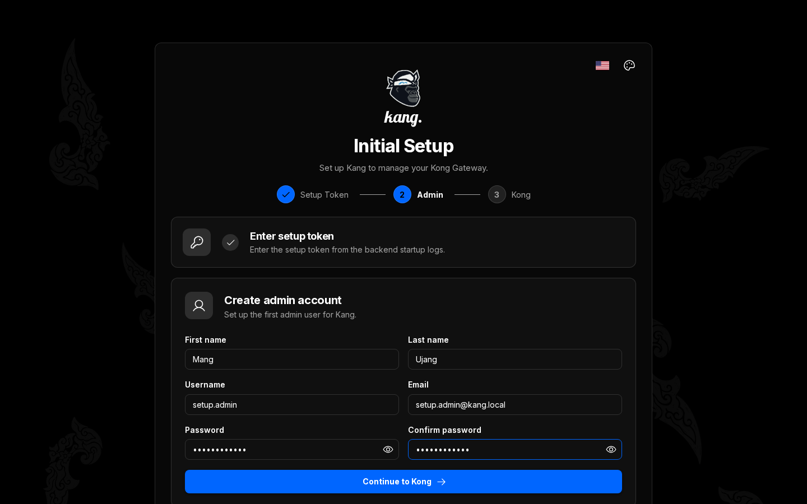
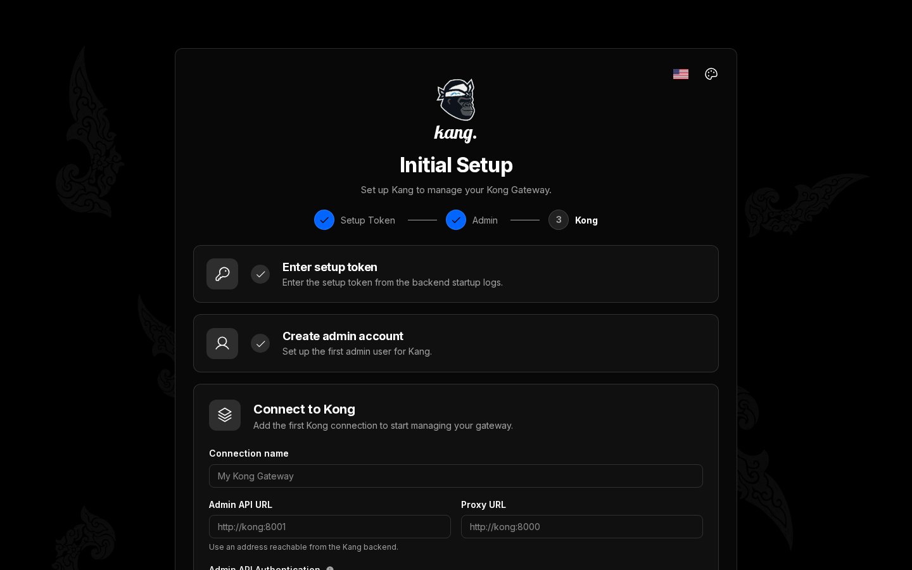
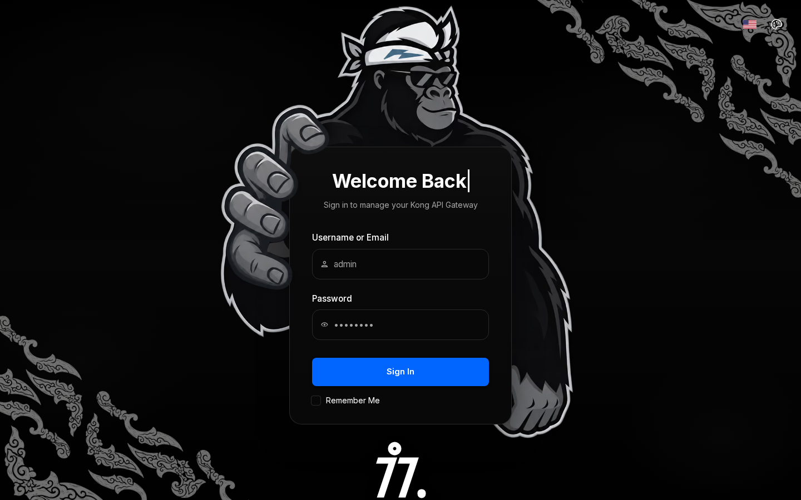

## Sebelum memulai

Siapkan URL frontend Kang, Admin API Kong yang dapat dijangkau, dan autentikasinya. Token setup hanya dibutuhkan administrator pertama. Jika organisasi sudah menggunakan Kang, mintalah akun kepada administrator, bukan melakukan setup ulang.

## Selesaikan wizard setup

1. Buka Kang. Instalasi baru mengarahkan Anda ke `/setup`.
2. Ambil token setup sekali pakai dari log startup backend. Untuk Compose, jalankan `docker compose logs backend` dari folder `compose`. Jaga kerahasiaan token.
3. Masukkan token, lalu detail akun administrator pertama. Ikuti kebijakan password pada form; operator instalasi dapat mengaturnya.
4. Masukkan nama, proxy URL, Admin API URL, dan autentikasi koneksi Kong pertama.
5. Uji koneksi dan selesaikan error sebelum melanjutkan. Backend Kang, bukan browser Anda, harus dapat menjangkau Admin API.
6. Selesaikan wizard lalu masuk. Administrator dibuat pada langkah terakhir setelah koneksi berhasil diuji. Jika setup terputus setelah akun dibuat, masuk menggunakan akun tersebut untuk melanjutkan.

Langkah sebelumnya dapat dibuka kembali untuk mengoreksi data. Field koneksi tetap tersimpan ketika kembali ke langkah administrator.

## Masuk ke instalasi yang sudah ada

Buka `/login`, masukkan username atau email serta password, lalu pilih **Sign In**. Placeholder `admin` hanya contoh, bukan username atau password bawaan. Gunakan akun Anda. **Remember Me** memengaruhi persistensi sesi sesuai konfigurasi autentikasi instalasi.

Jika diminta mengganti password, selesaikan sebelum melanjutkan. Untuk akun nonaktif atau terkunci, hubungi administrator; mencoba login berulang kali tidak memulihkan akses.

## Pemeriksaan pertama

Pastikan nama gateway di sidebar sudah benar. Buka **Home** untuk melihat versi dan jumlah resource. Baca [koneksi](/kang/id/guides/connections/) sebelum mengubah production. Berhasil masuk ke Kang tidak berarti seluruh operasi di gateway diizinkan.
