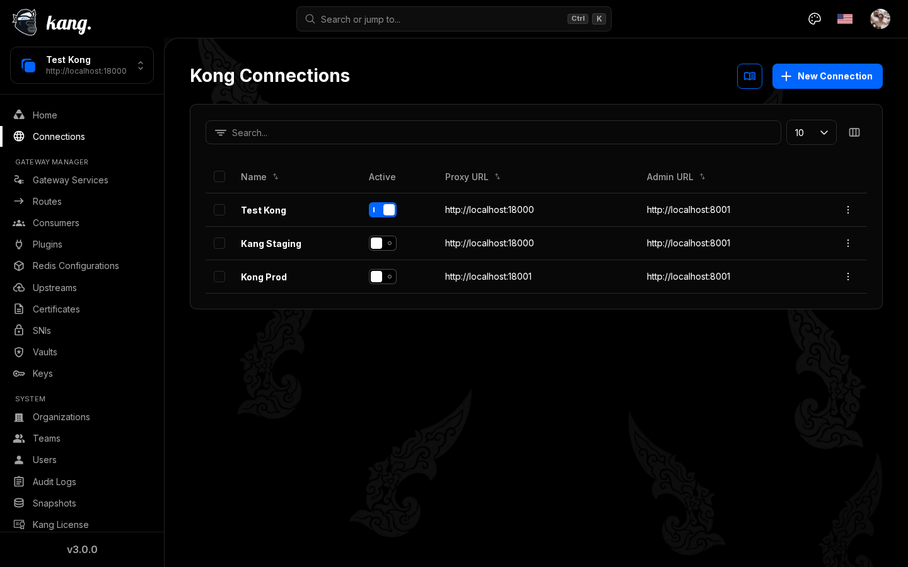

Connection menyimpan alamat dan autentikasi Admin API sebuah gateway Kong. Free menyediakan maksimal **2 koneksi per instalasi Kang**, bukan dua per pengguna. Pro menghapus batas paket tersebut; izin akses tetap berlaku.

## Menambah atau mengedit koneksi

1. Buka **Connections → New Connection**.
2. Masukkan nama yang jelas, seperti `Staging` atau `Production`.
3. Isi proxy URL untuk trafik API dan Admin API URL untuk pengelolaan. Keduanya biasanya berbeda.
4. Pilih autentikasi: **None**, **Kong Admin Token**, **Bearer Token**, **Basic Auth**, **API Key**, atau **Custom Header Token**.
5. Isi field sesuai metode. Basic Auth membutuhkan username dan password; API Key dan custom header membutuhkan nama header yang diharapkan. Prefix custom token bersifat opsional.
6. Gunakan **Test Connection**, lalu periksa hasil konektivitas dan kompatibilitas.
7. Jika memakai Pro dengan izin mengelola tim, pilih tim secara opsional, lalu simpan.

Saat mengedit, kredensial kosong dapat mempertahankan kredensial lama jika form menyatakan demikian. Mengganti metode autentikasi dapat memerlukan kredensial baru. Secret tersimpan tidak ditampilkan kembali oleh API.

## Konektivitas

Backend Kang harus dapat menjangkau Admin API. `localhost` dalam container menunjuk container itu sendiri, bukan host atau container lain. Gunakan DNS yang dapat dijangkau, Service Kubernetes, atau jaringan Docker bersama. Jangan memasukkan kredensial langsung ke URL.

## Berpindah environment

Pemilih koneksi di sidebar mendukung pencarian, tombol panah, dan membuka koneksi di tab baru. Saat berpindah dari daftar, halaman daftar dipertahankan: `/services` tetap `/services`. Halaman detail atau edit kembali ke daftar resource karena ID tersebut belum tentu ada di gateway lain.

Setiap tab memiliki `instance` eksplisit di URL. Buka staging dan production di tab berbeda untuk bekerja berdampingan. Jika mengganti koneksi saat mengisi form, muncul konfirmasi membuang form; gunakan ikon tab baru untuk mempertahankan form saat ini.

## Urutan koneksi bawaan

Sidebar dan tabel Connections menempatkan koneksi aktif di atas, lalu mengurutkan koneksi lain dari yang paling sering Anda buka. Jika jumlahnya sama atau belum ada riwayat, urutannya alfabetis. Riwayat melekat pada akun dan tersedia lintas perangkat. Yang dihitung adalah perpindahan yang Anda pilih dan aksi **Open in new tab**, bukan refresh, perpindahan yang dibatalkan, atau trafik gateway. Sortir kolom tabel tetap bisa mengubah urutan koneksi lainnya.

## Membagikan tautan resource

Bagikan URL aplikasi yang sudah dideploy beserta `?instance=...`. Penerima harus masuk dan memiliki akses ke koneksi serta jenis resource tersebut. URL tidak memberikan izin baru. Tautan `localhost` menunjuk komputer penerima sendiri sehingga tidak cocok untuk instalasi bersama.

Menghapus koneksi menghapus record koneksi di Kang, bukan meng-uninstall Kong. Saat kuota Free penuh, penambahan koneksi memerlukan penghapusan record yang tidak dibutuhkan atau upgrade instalasi.
