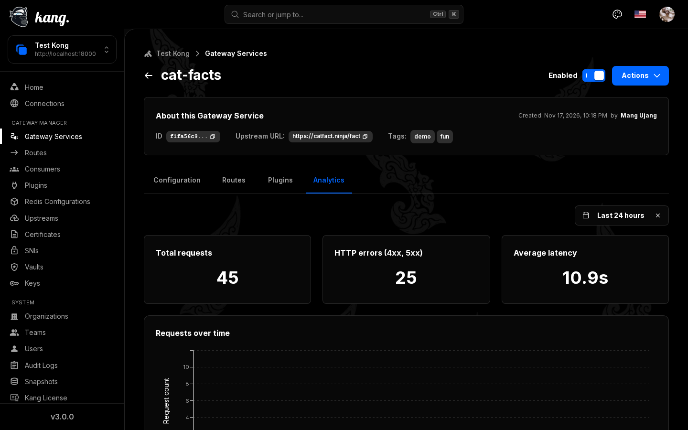

Tampilan analytics Kang ditenagai oleh **plugin prometheus Kong** yang mengirim data ke **metrics store yang kompatibel dengan Prometheus** dan di-query oleh backend Kang. Tidak ada yang terhubung otomatis: aktifkan plugin di Kong, scrape endpoint status-nya, arahkan backend ke store, lalu nyalakan analytics di aplikasi.

```text
Kong data plane ──status port :8100 /metrics──▶ Prometheus / VictoriaMetrics
                                                        │  PROMETHEUS_URL
                                                        ▼
                                              Kang backend :8080
                                                        │  /api/v1/prometheus/*
                                                        ▼
                                             Dashboard Kang (tampilan analytics)
```



## 1. Aktifkan plugin di Kong

Tambahkan plugin melalui Kong Admin API:

```sh
curl -X POST http://localhost:8001/plugins \
  --data name=prometheus \
  --data config.status_code_metrics=true \
  --data config.latency_metrics=true \
  --data config.bandwidth_metrics=true \
  --data config.upstream_health_metrics=true
```

Plugin mengekspos metrik di **status listener** Kong (default port `8100`), bukan di listener proxy atau admin. Pastikan aktif — di `kong.conf` set `status_listen = 0.0.0.0:8100`, atau di Docker/Kubernetes set `KONG_STATUS_LISTEN=0.0.0.0:8100` pada data plane. Verifikasi:

```sh
curl -s http://<host-kong-data-plane>:8100/metrics | head
```

Anda akan melihat `kong_http_requests_total`, `kong_request_latency_ms_*`, `kong_bandwidth_*`, dan series terkait lainnya.

## 2. Jalankan dan konfigurasi metrics store

Query API yang kompatibel dengan Prometheus apa pun bisa dipakai. Store harus bisa menjangkau endpoint status Kong.

### VictoriaMetrics (single node, Docker)

> [!IMPORTANT]
> **Nama job scrape harus sama dengan hostname dari Proxy URL koneksi Kang.** Kang menurunkan matcher PromQL `job` dari hostname itu (koneksi dengan proxy URL `http://localhost:18000` me-query `job="localhost"`; `http://kong-gw.internal:8000` me-query `job="kong-gw.internal"`). Kalau namanya tidak cocok, dashboard tetap kosong meskipun scraping berjalan.

```sh
cat > vm.yml <<'EOF'
global:
  scrape_interval: 15s
scrape_configs:
  # job_name = hostname dari Proxy URL koneksi Kang
  - job_name: localhost
    static_configs:
      - targets: ["kong-data-plane:8100"]   # hostname atau IP data plane Kong yang reachable
EOF

docker run --rm --name victoria-metrics -p 127.0.0.1:9090:9090 \
  --network <network-yang-dipakai-kong> \
  -v "$PWD/vm.yml:/etc/vm.yml:ro" \
  -v victoria-metrics-data:/victoria-metrics-data \
  victoriametrics/victoria-metrics:latest \
  -httpListenAddr=:9090 -storageDataPath=/victoria-metrics-data \
  -promscrape.config=/etc/vm.yml
```

Jika Kong berjalan di host, target `host.docker.internal:8100` (Docker Desktop) atau IP host. Verifikasi scraping:

```sh
curl -s 'http://localhost:9090/api/v1/query?query=kong_http_requests_total{job="localhost"}'
```

### Prometheus

Pakai job `scrape_configs` yang sama di `prometheus.yml` dan jalankan Prometheus seperti biasa. Penyimpanan jangka panjang, retensi, dan backup data metrik di luar tanggung jawab Kang.

## 3. Arahkan backend ke store

Set `PROMETHEUS_URL` untuk proses backend (misalnya `http://localhost:9090`), lalu restart. Cache opsional mempercepat query dashboard berulang; lihat [referensi environment backend](https://github.com/zaidanm16/kang-backend/blob/main/.env.example) (`PROMETHEUS_*`).

- **Docker Compose:** set `PROMETHEUS_URL` di `backend.env`. Gunakan nama service store metrik Anda, bukan `localhost`, agar bisa di-resolve antar container.
- **Chart Kubernetes:** dengan `metrics.enabled=true`, URL Service VictoriaMetrics bawaan otomatis dipasangkan ke backend.

## 4. Nyalakan analytics di aplikasi

Analytics adalah **preferensi per pengguna**. Buka **Profile → Preferences** (atau tekan **Turn on analytics** di halaman Overview). Saat mati, Kang sepenuhnya melewati request traffic-metrics agar halaman lebih cepat.

## Kubernetes (chart Helm)

Chart bisa menjalankan instance VictoriaMetrics single node dan menyuntikkan URL query-nya ke backend:

```yaml
metrics:
  enabled: true
  persistence:
    enabled: true
    size: 20Gi
  scrapeConfig: |
    global:
      scrape_interval: 15s
    scrape_configs:
      - job_name: kong
        static_configs:
          - targets: ["kong-status.my-kong-system.svc:8100"]
```

Kong bukan bagian dari chart, jadi Anda harus mengekspos status listener-nya sendiri — misalnya sebuah `Service` bernama `kong-status` yang menarget port `8100` pod data plane Kong. `metrics.scrapeConfig` diteruskan apa adanya ke VictoriaMetrics bawaan; secara bawaan ia tidak men-scrape apa pun. Alternatifnya set `metrics.externalUrl` (atau `metrics.existingSecret`) ke Prometheus/VictoriaMetrics yang sudah ada. Lihat [README chart](https://github.com/zaidanm16/kang/blob/main/charts/kang/README.md).

## Apa yang ditampilkan dashboard

Dengan analytics aktif, halaman Overview men-query window terkini (default 7 hari terakhir) untuk total request, error rate, dan rata-rata latency; ranking per service, per route, dan per consumer; serta tren traffic dan latency dari waktu ke waktu. Halaman detail service, route, dan consumer punya tab analytics masing-masing.

## Troubleshooting

| Gejala | Periksa |
| --- | --- |
| "Analytics is turned off" di Overview | Ini preferensi per pengguna — nyalakan di Profile → Preferences. |
| "No data" atau chart kosong | Apakah `kong_http_requests_total` ada di query API store? Apakah scrape job `up == 1`? |
| Store tidak mengembalikan apa-apa untuk query Kong | Plugin prometheus belum aktif, status listener mati, atau store tidak bisa menjangkau endpoint status. |
| Store scraping, dashboard tetap kosong | `PROMETHEUS_URL` tidak menunjuk ke store, atau backend tidak bisa me-resolve-nya (container vs host). |
| Metrik berhenti setelah Kong restart | Konfigurasi status listener hilang — periksa ulang `KONG_STATUS_LISTEN` / `status_listen`. |
